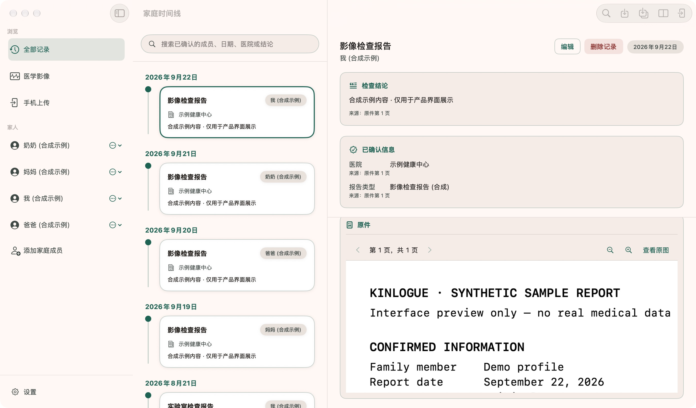

<p align="center">
  
</p>

<h1 align="center">续页 · Kinlogue</h1>

<p align="center">
  <strong>你和家人的健康记录，前后相续。</strong><br>
  <em>Your health history and your family’s, continued.</em>
</p>

<p align="center">
  macOS 26+ · Swift 6 · Local-first · GPL-3.0
</p>

<p align="center">
  
</p>

<p align="center">
  <sub>产品界面预览 · 仅使用合成示例数据，不包含真实健康资料</sub>
</p>

续页（英文名 **Kinlogue**，读作 **KIN-log**）是一款 Mac 优先、隐私优先的健康记录应用。它以人为单位整理资料：一位使用者可以在同一台 Mac 上为自己和每位家人各建一条时间线，把散落在 PDF 与图片里的检查报告、化验单和门诊记录按人与时间串联起来，让历史资料在下一次复诊时随手可查。

*Kinlogue keeps a continuous health history for you and each person in your family, ready for every follow-up.*

> [!IMPORTANT]
> 当前源码仍是发布前开发候选，不是已完成公共发布的产品。候选身份、自动化状态和人工门禁以 [当前候选证据](docs/acceptance/current-release.md) 为准。

续页负责整理、检索和呈现可信的原始记录，不替代医生，也不提供诊断、趋势判断或治疗建议。

## 为什么做续页

一份报告往往只回答一次检查的问题，真正影响复诊效率的却是它与过去资料的关系。文件可能散落在手机相册、聊天记录、下载目录和不同家人的文件夹里；纸质报告放久了字迹会褪色，有些医院的线上报告也只能在一段时间内查看或下载。等到需要回顾时，原件可能已经找不全，人们还要重新辨认日期、项目与前后变化。

续页希望把这个过程变得简单而可信：保留原件，用本机 OCR 帮忙转录，让用户确认关键信息，再把一页页报告续成可以搜索、回看和比较的健康历史。

## 核心体验

- **一人一条线，一人管全家**：每位家庭成员都有自己的资料与时间线，由同一位使用者在一台 Mac 上统一管理。
- **保留可信原件**：导入 PDF 和报告图片，记录转录内容对应的来源页。
- **本机 OCR**：使用 macOS Vision / PDFKit 在设备上提取文字，不把报告发送到云端。
- **先确认，再入档**：OCR 只生成候选；用户确认后，记录才进入时间线、搜索和比较。复核时会列出几种常见的识别误读，例如把“↑”读成“个”，由你逐条采纳或忽略；识别规则改进后，已确认的报告也可以逐项对照后按新规则重新整理。
- **前后对照**：搜索已确认记录，命中的词会加粗标出；搜索词落在检验表格里时，按日期逐格列出报告上的原文行；落在超声、CT 等报告的所见或结论里时，列出含这个词的原句；落在其他字段里时显示命中处的上下文。也可以并排查看两份记录的历史结论与原件。
- **备份即导出**：把完整资料库写成一个 ZIP 压缩包，保存到用户选择的文件夹或任意位置。解压后是按家庭成员和日期排好的原始文件，选中同一个压缩包就能整库恢复；压缩包不加密。
- **手机临时投递**：用户主动开启后，手机可在同一局域网中通过浏览器上传一份或多份报告。

```text
Mac 导入 / 手机临时投递 → 本机验证与 OCR → 人工确认 → 时间线、搜索与比较
```

## 隐私与医疗边界

| 边界 | 当前实现 |
| --- | --- |
| 数据处理 | 报告、OCR 和索引在这台 Mac 上处理；没有账号、内置云同步、iCloud、CloudKit、HealthKit、遥测或广告。备份只写用户选择的文件夹或位置。 |
| 本机存储 | App Sandbox 内的资料库目前是**明文存储**，不使用应用层加密或 Keychain。 |
| 数据备份 | 备份压缩包**不加密**，包含全部健康资料；放进网盘同步文件夹，网盘服务商和能登录该账号的人都能读取。续页只验证文件夹中的本地文件，无法证明阿里云盘、百度网盘或其他客户端已经上传。 |
| 手机投递 | 只在用户主动开启的临时会话中工作；监听所选 Mac 接口，并在 HTTP 前限制为该接口的 IPv4/IPv6 网络前缀。传输仍是普通 HTTP，仅适合可信任的私人 Wi-Fi 或有线局域网。 |
| 内容可信度 | OCR 是待确认的来源转录，不是医学解释；只有用户确认的记录进入正常查询。 |
| 删除范围 | 续页只管理 App 自己保存的副本，无法删除原始源文件、Time Machine 备份、APFS 快照或其他外部副本。 |

这些限制是当前产品设计的一部分，不应被“本机优先”或“隐私优先”的表述掩盖。完整说明见 [隐私说明](PRIVACY.md) 和 [隐私与安全工程文档](docs/privacy-and-security.md)。

Mac App 界面当前支持简体中文和英文。默认跟随 macOS 的 App 语言偏好，也可以在侧栏“设置”中即时选择“简体中文”或 “English”；选择会保存在当前 Mac 用户的 App 偏好中。OCR 关键词和用户导入的报告文字属于内容数据，不会因界面语言切换而翻译或改写；实现与新增文案流程见 [本地化说明](docs/localization.md)。

## 从手机接收资料

在侧栏打开“手机上传”，点“从手机接收”，确认当前是可信任的私人 Wi-Fi 或有线局域网后开始接收。手机与 Mac 连接同一局域网时，可扫描二维码或在浏览器输入页面上的地址，再输入一次性验证码。手机页面是一个可以反复追加图片或 PDF 的文件列表，不需要先分报告或排序；上传完成后，Mac 会把相同原件合并到单一待确认队列。用户可以单选或多选原件，在 Mac 上确认报告页序、家庭成员和日期，再作为一份报告加入“等待确认”。

切换网络、锁定或睡眠 Mac、关闭最后一个主窗口、退出 App 或主动停止，都会终止当前会话；会话不会自动恢复。手机页面只显示本次会话的上传状态，不能浏览 Mac 上的成员、历史记录、OCR、时间线或原件。协议、生命周期与排障说明见 [局域网上传文档](docs/lan-upload.md)。

手机只在有界逐块比较确认字节完全相同时忽略重复选择；无法确认时仍会上传，由 Mac 使用 SHA-256 和长度做权威合并。若所选原件与已有报告完全一致，Mac 会复用已有报告而不重复创建；部分重合或近似内容仍由用户确认。

## 医学影像文件夹

当前源码提供独立的 DICOM 文件夹导入、人工确认、与报告同列的成员时间线入口（可按“全部 / 报告 / 影像”筛选）和受限的本机二维 Viewer。DICOM 原件、自由文本和像素不进入报告 OCR、搜索或比较；该能力不提供诊断、测量或通用影像工作站功能。准确的格式、交互和未验证边界见 [DICOM 专题](docs/dicom.md) 与 [验收矩阵](docs/acceptance/dicom-mri-viewer-matrix.md)。

## 备份、导出与恢复

“设置 → 数据备份与导出”只有一种文件：`.zip` 备份包。它包含索引文件 `kinlogue-backup.json`、资料库的完整数据 `data/library.klog`（成员、报告、识别文字与复核、草稿、手机上传、DICOM 索引），以及 `files/` 下的全部原件：已确认的报告和影像按家庭成员与日期排列，草稿、待确认影像和手机待整理的原件放在名称以 `_` 开头的文件夹里。解压后可以直接打开或打印原件，也可以只把某位成员的文件夹发给医生；整份备份含有全家所有人的资料，不要直接交出去。

- **备份到文件夹**：选择一个文件夹后，可以“立即备份”，也可以打开自动备份（续页运行时，资料变化后每天最多一次）。每份备份都有自己的文件名，从不覆盖已有文件。
- **保留份数**：默认保留最近 5 份，可设为 1–30 份。超出时续页只删除自己写入、之后没有被改名、移动或修改的备份；文件夹里的其他文件、改过名的备份和其他 Mac 写入的备份都不会被删除。
- **导出备份到…**：用系统保存面板把同样的压缩包存到任意位置，不计入保留份数。
- **从备份恢复…**：选择一个备份压缩包，续页完整验证后显示备份时间和数量概要，确认后替换（而不是合并）当前资料库，然后退出并重新打开。恢复后备份文件夹设置保留，自动备份会关闭。

备份和导出都先在目标所在卷的私有工作文件中写完、完整读回校验，再发布；提交前可以取消。备份包**不加密**：任何拿到文件的人都能读到其中全部内容。需要保护时，请把备份文件夹放在开启了 FileVault 的磁盘、加密的外置盘或加密磁盘映像上。早期版本写入的加密 `.kinloguebackup` 恢复点不能被当前版本读取。详见 [备份与恢复](docs/backup-and-restore.md)。

## 当前版本

源码仓库已公开，但项目尚未正式发布可下载产品。当前版本、最低系统、自动化状态和人工门禁只在 [当前候选证据](docs/acceptance/current-release.md) 维护；验证命令见 [测试与发布](docs/testing-and-release.md)。

## 当前存储边界

报告原件、DICOM 原件与索引、手机上传待确认项、成员资料、OCR 结果和搜索字段会被复制到 App Sandbox 内的本机资料库。当前版本不进行应用层加密，也不使用 Keychain。能够访问当前 macOS 用户资料的人员或软件，以及包含资料库的 Time Machine 备份、APFS 快照或其他副本，可能读取这些内容。

资料库把记录保存在一个本机 SQLite 数据库里、把原件保存为不可变文件，记录与其引用的原件在同一事务中发布；SHA-256 摘要只用于发现意外损坏和本机去重，不提供保密性、身份认证或针对恶意回滚的保护。上传完成的唯一原件会保留在待确认队列，直到用户明确删除或将其成功归档；归档失败不会移除队列项。进入报告等待确认后，删除投递箱接收副本不会删除已经归档的原件。当前版本提供写入用户选择位置的明文 ZIP 备份与整库恢复，但不提供内置云同步。

## 本机构建

要求 macOS 26 或更高版本，以及包含 Swift 6.2 或更新版本的 Xcode 或 Command Line Tools。

```sh
scripts/lint.sh
swift build --disable-sandbox
scripts/compile-localizations.sh --check
scripts/test.sh
```

完整 Xcode 环境还可以构建并验证本机测试 App（DICOM 构建需安装 Metal Toolchain，见[环境说明](docs/testing-and-release.md)）：

```sh
scripts/verify-app.sh
scripts/build-acceptance-app.sh
scripts/run-acceptance.sh
```

`scripts/verify-app.sh` 会重新构建正式的 `dist/Kinlogue.app`，检查架构、Info.plist、签名、仅含入站服务的精确 entitlement allow-list、中英本地化资源与局域网用途说明、内嵌手机页面、无原始请求内容日志、无 Security.framework 直接依赖及无旧加密运行时代码，并生成 `dist/verification-report.json`。安装验收只使用合成资料，不应访问真实病历；自动验收通过也不会替代真实设备、真实样本 OCR、键盘或 VoiceOver 等人工门禁。完整前置条件和结果解释见 [测试与发布](docs/testing-and-release.md)。

## 品牌

- **续页**：每个人的健康资料一页页延续，新的一页总能接上过去。
- **Kinlogue**：`Kin` 指自己和家人，`-logue` 联想到记录、档案与对话。
- **定位**：以人为单位，一人管全家。每位成员一条健康线索，由一位使用者统一照看。
- **图标意象**：纸页翻起一角，一条连续的线从页下延伸出来。纸页是有来源的原件，线是一个人前后相续的健康线索，三个节点是这条线上不同时间的记录。
- **图标文案**：**翻开一页，接上过去。**

品牌以深玉绿 `#1E6254`、暖象牙白 `#F7F1E4` 和柔和杏色 `#DF8A4A` 为母色，避免医疗十字、心电图、盾牌、云端或 AI 星光等符号。名称释义、图标母版与重新生成方式、文案规则，以及尚未实现的产品方向见 [品牌说明](docs/brand.md)；界面令牌、交互状态和无障碍取舍见 [Warm Sanctuary 设计系统](docs/design-system.md)。

## CI/CD 与候选分发

仓库内的 GitHub CI 会在 pull request 和 `main` push 上执行 lint、隐私门禁、全量测试与正式 bundle/XPC 验证，并以 30 分钟为异常硬上限；macOS 26 为基线，Xcode 27 预览镜像只在 `main` push 和手工触发时执行同样的兼容性矩阵，其失败暂不阻塞基线。独立 CodeQL workflow 在 macOS runner 上分析 Swift。Dependabot 检查 SwiftPM 与 GitHub Actions 更新。推送与 `Info.plist` 版本一致的 tag 后，distribution workflow 不需要 Apple 开发者账号或 Secrets，会生成经过复验的 Apple Silicon ad-hoc ZIP，并发布为 GitHub Pre-release。

公开仓库中的 Pre-release 对任何人可见，但仍只是知情测试候选。校验 SHA-256、解压并拖入当前用户的“应用程序”文件夹后，首次打开需要在 macOS“系统设置 → 隐私与安全性”中明确选择“仍要打开”。不要关闭 Gatekeeper，也不要递归删除 quarantine 属性。

该候选包没有 Developer ID 签名和 notarization，macOS 无法验证开发者身份或 Apple 恶意软件检查状态，只适合作为知情测试者主动下载的候选包，不能据此声称已经正式发布。未来取得 Apple 凭据后可使用 `scripts/package-distribution.sh` 生成 Developer ID/notarized 草稿证据，但仍需完成兼容性和真实设备门禁。存储是否加密与是否具备分发签名是两个独立问题。安装方式和仍未完成的门禁见 [ad-hoc 候选包安装说明](docs/adhoc-candidate-install.md) 与 [测试、构建与发布验收](docs/testing-and-release.md#ci)。

## 项目结构与文档

| 目录 | 责任 |
| --- | --- |
| `Sources/KinlogueCore/` | Foundation-only 领域模型、状态机与跨平台规则 |
| `Sources/KinloguePlatform/` | 明文 Vault、OCR、文件处理与 LAN receiver / inbox |
| `Sources/KinlogueApp/` | SwiftUI / AppKit composition root、服务、ViewModel 与界面 |
| `Tests/` | 单元、集成、并发、脚本安全与安装验收测试 |

SwiftPM manifest 是 App 的构建与测试入口；当前只发布 `Kinlogue` executable product，Core、Platform 与测试辅助 target 不承诺稳定的公共 library API。

- [项目知识库索引](docs/index.md)：产品、架构、数据、存储、OCR、LAN、隐私和验收导航。
- [项目总览](docs/project-overview.md)：当前能力、用户流程、非目标和发布状态。
- [品牌说明](docs/brand.md)：名称、定位、标语、应用图标和尚未实现的产品方向。
- [Agent 工作约束](AGENTS.md)：事实优先级、安全边界、修改流程和验证要求。
- [架构说明](docs/architecture.md)：SwiftPM 分层、运行时组装和主要数据流。
- [贡献指南](CONTRIBUTING.md)：开发流程、合成数据规则和 PR 要求。
- [安全报告](SECURITY.md)：私密漏洞报告渠道和披露边界。
- [行为准则](CODE_OF_CONDUCT.md)：参与规范与执行方式。

## 私密测试资料

真实病历不得复制进仓库、测试夹具、日志、截图、构建目录或 App bundle。自动化测试只创建合成资料。需要使用私有样本时，只能从仓库外位置在关闭内容日志和截图后做本机人工抽检。

公开源码前必须同时通过当前工作树门禁和 Git reachable-history 门禁；删除当前文件不能清除旧 commit 中的内容。公开仓库应从经过审计的净化快照建立，并只保留通过历史门禁的 branch/tag。

## License

Kinlogue is licensed under the [GNU General Public License v3.0](LICENSE).
