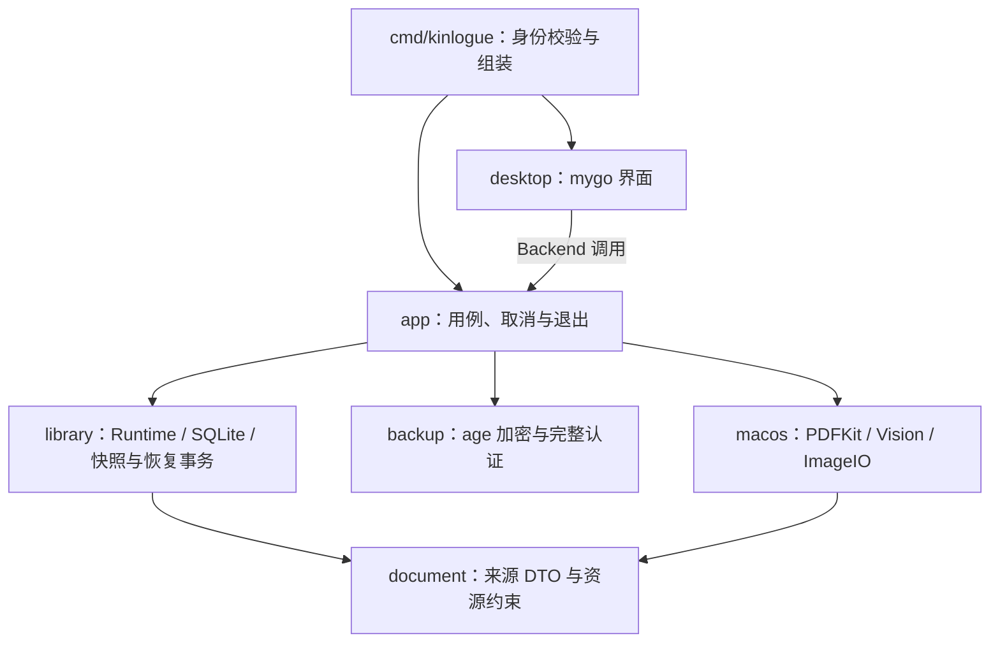

# Go 原生界面预览版

Kinlogue 在同一仓库内开发独立的 Go 预览版。报告整理闭环已扩展到多原件分组与排序、确认后纠错、单份报告原件导出和报告删除；Swift 应用继续作为功能和交互对照，尚未完成全功能替换。Go 预览拥有独立资料格式，当前源码提供已知 Go v1/v2/v3 到 v4 的事务升级，不读取或迁移 Swift 资料或备份。

本文维护 Go 预览的实现和验证边界；现有[项目总览](project-overview.md)、[Swift 架构](architecture.md)和[当前候选证据](acceptance/current-release.md)继续描述 Swift 基线。需求和取舍分别见[首阶段计划](plans/2026-10-07-0812-feat-go-native-report-workflow-plan.md)与[日常报告操作计划](plans/2026-10-07-feat-go-daily-report-workflow-plan.md)；依赖依据见[原始来源笔记](sources/mygo-native-2026-10-07.md)和[mygo 本地补丁来源追加](sources/mygo-local-patch-2026-10-07.md)。下文区分当前代码能力、自动化、2026-10-08/09 实际窗口验证和首阶段历史证据。

## 当前功能与流程

1. 创建家庭成员，从系统文件面板选择报告。多选时明确选择分别导入，或调整顺序后组合为一份报告；一份报告最多 20 个原件。PDF、JPEG、PNG、HEIC 和单帧 TIFF 由内容识别，不信任扩展名；重复导入不会自动去重或跨成员合并。
2. App 逐件复制并持久化原件，全部成功后才发布一份报告的关系，再逐来源执行本机识别。PDF 优先使用文本层，没有可用文本的页面转成有界图像交给 Vision；图片通过 ImageIO 调整方向后交给 Vision。部分来源成功时仍不能复核或确认，显式重试只补齐缺少的识别。
3. 在复核页选择原件及该原件内的页码，对照初始识别、调整原件顺序，并修改标题、日期、来源转录、备注和归属成员。同一 PDF 的内部页序不改动。日期由日历选择器选择或明确设为“日期未知”，以 `YYYY-MM-DD` 保存；不从 OCR 推断检查日期。
4. 可以暂存草稿后继续核对；有未保存修改时，切换记录或关闭窗口会先处理保存、放弃或取消。只有明确确认后，记录才进入“全部记录”和所选成员的时间线、搜索。
5. 搜索覆盖已确认的标题、修正后转录和备注。中文按字面子串匹配，英文 ASCII 大小写不敏感；`%`、`_` 等按普通字符处理。原始 OCR、失败任务和未确认草稿不进入搜索。
6. 确认记录默认只读；明确进入编辑后可以修改复核字段及原件顺序，保存时一次提交，取消则回到已保存内容。原始识别不随修改重写；原件重新排序不触发 OCR。
7. 可以明确删除草稿或已确认报告，也可以经明文提示和系统保存面板，将当前一份已确认报告的原件导出为 ZIP。删除与导出的准确范围见下文；重启不会自动启动识别。
8. 从侧栏“设置 → 备份与恢复”创建手动加密整库备份，每次独立保存并复输恢复码，再选择目标文件。恢复先完整验证并显示摘要，明确确认后替换整个 Go 资料库，成功或激活失败都须退出重启；资料库内容损坏时仍可进入独立恢复界面。格式、限制和旧库保留边界见 [Go 备份专题](go-backup-and-restore.md)。

界面支持简体中文、English 和跟随系统，选择保存在新资料库中。跟随系统时，中文系统语言使用简体中文，其余回退到英文；这与 Swift 的语言回退策略独立。长期界面状态保存语义错误码，在绘制时翻译，不改写报告内容。资源和交互见 [`internal/desktop/`](../internal/desktop/)，启动文案见 [`cmd/kinlogue/main.go`](../cmd/kinlogue/main.go)。

原生保存、关闭、退出和导入入口先等待当前帧将排队输入写入字段，再检查保存或未保存修改保护；同帧关闭优先于导入和保存。输入法仍在组字时，本次原生操作不执行，也不在组字结束后自动重放，用户须在提交或取消候选后重新操作。对应时序回归见 [`daily_test.go`](../internal/desktop/daily_test.go)。实际窗口已检查英文编辑的撤销/重做、未保存时 Cmd+W 的取消保护、Cmd+S 保存及 Cmd+Q 后重开；真实拼音输入的候选取消、提交和撤销，以及组字期间 Cmd+S/W 保护也已通过。首字符后立即导航的完整矩阵仍待验收。

[手机上传](go-lan-upload.md)已按 Swift 基线开启：入站网络权限、二维码与一次性验证码配对、15 分钟无活动超时、生命周期与网络变化撤销、持久队列和多选删除均已接通；真实手机和网络切换仍待验收，锁屏不保证停止接收。尚未实现自动备份、整库明文导出、DICOM、指标比较、结构化医学字段、成员归档或大模型接入。[手动加密备份恢复计划](plans/2026-10-08-1702-feat-go-backup-restore-plan.md)保留设计约束；底层测试不能替代完整应用验收。暂时不要把预览版作为真实资料的唯一保存位置。

## 与 Swift 基线的界面对齐

2026-10-09 的调整以 [Warm Sanctuary 规范](design-system.md)、Swift 的 AppShellView / TimelineView / RecordDetailView 和仓库[合成界面图](assets/kinlogue-overview.jpg)为对照。浏览页面采用“成员侧栏—时间线—报告详情”三栏；打开记录保留时间线，确认详情上方展示来源转录与备注卡片，下方独立滚动查看原件。复核和编辑仍保留原件与表单对照，切换记录经过帧末输入、组字与未保存修改保护。

侧栏使用暖白底、浅暖色选中行和深绿文字，设置固定于底部；导入放在内容顶部。时间线按日期分组、显示成员标签和选中卡片；“全部记录”默认汇总本机所有成员的已确认报告，成员入口仍限定范围。`Store.Search` 的空成员 ID 表示全部成员，非空 ID 继续校验并使用成员条件；草稿和初始 OCR 不进入任一确认搜索。设置页集中语言和现有备份恢复，以说明卡片和右侧等宽控件排列。

这是已实现报告流程的视觉与导航对齐；当时未增加 Swift 的 LAN、DICOM、比较或结构化医学字段，手机上传随后单独接入，见 [Go 手机上传](go-lan-upload.md)。

2026-10-10 第二轮逐屏对照 Swift 的 AppShellView、MemberSidebarView、TimelineView、RecordDetailView、ImportReviewView、RecordEditView、SettingsView 及手机上传各视图，并在已实现范围内改为相同结构：

- 侧栏按“浏览 / 家人 / 待确认 / 导入状态”分区，底部是设置；草稿不再作为单独页面，而是在“待确认”中逐条列出、点开即复核；识别中或失败的草稿在“导入状态”中重试或放弃。顶部一行代替 Swift 窗口工具栏，放导航标题、“导入报告”和“手机上传”。
- 中栏顶部始终是胶囊搜索；时间线卡片使用 12pt 绿点与淡绿竖线、白色 16pt 圆角卡片、右侧成员标签，日期分组按“2025年11月22日”格式。
- 详情为标题加成员，右侧“编辑 / 导出原件… / 删除记录”和日期标签，下方 Container 信息卡（检查结果、我的备注）与带标题的原件区。
- 复核和确认后编辑改为与 Swift 相同的弹出窗口（左侧原件、右侧表单），底部分别为“放弃导入… / 稍后处理 / 确认并加入时间线”和“取消 / 保存”；窗口外点击不会关闭。弹窗打开时其他导航被阻止，关闭窗口或退出仍经过未保存修改保护。
- 设置按“通用”“数据备份”分区，白色卡片与右侧 220pt 控件列。
- 中英文文案按 Swift 本地化原文更新；图标为项目自绘线条图标，不复制 SF Symbols。

与 Swift 的已知差异：Go 没有医院、科室、结论等结构化字段，因此卡片只展示检查结果转录与备注，时间线第二行显示原件文件名；搜索只覆盖标题、转录和备注，搜索框文案相应写为“搜索已确认的记录”；没有独立的“查看原图”缩放窗口、医学影像和比较入口。合成截图由 `KINLOGUE_UI_EVIDENCE` 驱动的 [`evidence_test.go`](../internal/desktop/evidence_test.go) 生成，默认跳过，不代表实际窗口或 VoiceOver 验收。控件由 mygo 绘制，不宣称逐像素或完整无障碍等价。行为覆盖见 [`layout_test.go`](../internal/desktop/layout_test.go)、[`desktop_test.go`](../internal/desktop/desktop_test.go) 和 [`store_test.go`](../internal/library/store_test.go)。

同日按易用性复盘做了一轮有意偏离 Swift 的调整：进入时间线时自动打开最新一条，空详情只显示一个提示；详情只保留“编辑”，“导出原件…”和“删除记录”收进“更多操作”菜单，日期与成员一起放在标题下；单个成员的时间线不再在每张卡片上重复成员标签；复核、编辑和手机归档的日期改用日历选择器，并可明确设为“日期未知”；手机归档不再预选成员，可选原件显示勾选圈，选中后才展开归档表单；侧栏“待确认”显示数量和每份草稿的标题或文件名；成功结果以 toast 短暂提示，错误留在页面并带警示图标；Cmd+F 聚焦搜索，复核与编辑弹窗中 Cmd+Return 执行主操作，组字未结束时不触发。行为由 [`ux_test.go`](../internal/desktop/ux_test.go) 覆盖。

## 模块与运行时

应用逻辑和界面代码使用 Go。mygo 的 native UI 是 GPU 自绘控件；窗口和系统文件面板使用平台能力，不能据此宣称每个控件都是 AppKit 控件或已经达到 SwiftUI 的无障碍效果。[mygo v0.2.15 说明](https://github.com/egoist/mygo/tree/v0.2.15)及[上游路线图](https://github.com/egoist/mygo/issues/105)仍将文本/集合无障碍、控件本地化和原生视图嵌入列为完善方向。



| 位置 | 责任 |
| --- | --- |
| [`cmd/kinlogue/main.go`](../cmd/kinlogue/main.go) | 校验独立应用身份、组装 Runtime/Processor/Service/BackupController，选择正常或恢复界面并统一关闭 owner。 |
| [`internal/document/`](../internal/document/) | 页码、归一化区域、原始文本、置信度、引擎标识、资源上限与民用日期校验。 |
| [`internal/library/`](../internal/library/) | 成员、报告、确认门、搜索、语言、逻辑快照及整库恢复事务。 |
| [`internal/backup/`](../internal/backup/) | 单备份恢复码、流式 age 加解密、真正 EOF 认证和回读摘要验证。 |
| [`internal/macos/`](../internal/macos/) | 通过 purego 调用公开 Foundation、PDFKit、Vision、ImageIO 和 CoreGraphics API。 |
| [`internal/app/`](../internal/app/) | 串行命令、识别状态推进、重试、取消、备份恢复控制器和退出等待。 |
| [`internal/desktop/`](../internal/desktop/) | 主窗口、复核表单、原件预览、未保存修改处理和中英文文案；不在 UI 中创建存储或识别器。 |

依赖固定在 [`go.mod`](../go.mod) 和 [`go.sum`](../go.sum)：mygo `v0.2.15`、purego `v0.11.1`、modernc SQLite `v1.60.1`、age `v1.3.2`、hpke `v0.4.0`、`golang.org/x/crypto v0.55.0` 与 `golang.org/x/sys v0.48.0`；打包工具链固定 Go `1.27.2`。mygo 通过唯一的本地 `replace` 使用仓库内 [`third_party/mygo/`](../third_party/mygo/) 的锁定源码及输入修正，**不是未修改的上游 v0.2.15**；来源、修改清单和 MIT 许可见 [`SOURCE.md`](../third_party/mygo/SOURCE.md)。补丁处理输入法预编辑取消、提交与撤销边界，不能把无窗口事件测试写成真实中文输入法或 VoiceOver 已验收。

生产包以 `CGO_ENABLED=0` 构建，不包含 Swift helper；系统识别仍依赖 macOS，当前应用不是跨平台实现。预览包声明最低 macOS 14，声明本身不等于已完成该系统的运行验证。

`app.Processor` 是当前识别边界，生产实现仅使用 Apple 本机识别。未来模型接入还需独立设计用户授权、发送范围、失败/费用处理、凭据生命周期和隐私说明；模型结果仍必须经过来源核对与人工确认。本轮没有网络客户端或模型调用；临时手机配对与模型认证无关。

## 独立身份、存储和生命周期

预览包为 `KinlogueGoPreview.app`，bundle ID 为 `com.kinlogue.mac.gopreview`。启动从 `NSBundle` 核对身份，再从 `NSFileManager` 取得沙盒感知的 Application Support 目录，在其中使用固定子目录 `KinlogueGoPreview/Library`。不通过环境变量、命令行、当前目录或用户输入指定生产资料根目录，不扫描、迁移或改写 Swift Vault。

资料库使用明文 `library.sqlite` 和 `originals/<opaque-id>.blob`。数据库保存成员、草稿、原始识别、人工修正和设置；原件先完整写入并同步，再发布数据库引用。展示名只作为数据保存，不参与路径生成。读取原件会重新核对长度和 SHA-256；摘要只发现意外损坏，不提供保密或防篡改保证。

Store 保持一个 SQLite 连接、`DELETE` journal 和 `EXTRA` 同步设置；资料库生命周期持有排他文件锁，第二个实例不能同时打开。未知格式、损坏数据库或不符合私有目录约束的路径会拒绝打开。应用内写操作通过可取消队列串行执行，Store 再检查草稿状态，已经进入复核或确认的内容不能被迟到识别覆盖。退出停止接收命令、取消活动操作并等待它们结束，再关闭数据库。

Runtime 在 Store 之前持有固定父目录 lease 并收敛恢复 journal；格式或内容无法打开时进入恢复界面，目录身份、锁或 journal 不明确则拒绝启动。恢复替换先封闭命令入口、取消并等候已进入的操作、关闭 Store，再执行目录事务；不能在同一进程继续使用被替换的库。详情和强退证据见 [Go 备份专题](go-backup-and-restore.md)。

首次建库先同步空的私有 `.initializing` 目录；重启只在该标记有效、数据库版本和应用标识均为零、schema 与原件目录均为空时补建 schema，不接管任意零版本数据库。提交完成后复核同一标记再移除。原件写入失败时只清理本次创建且 inode 未被替换的 `.part` 文件，不移除已经发布的 `.blob`。对应强退重开、故障注入和路径替换回归见 [`recovery_test.go`](../internal/library/recovery_test.go)。

草稿与搜索列表只读取 metadata 摘要，转录、备注及完整 OCR 在选中记录后通过 `Get` 加载；搜索仍在数据库内匹配确认内容。UI 列表只构建可见范围的行。忙碌期间关闭窗口或退出会取消可取消的识别任务并等待清理；已进入保存的写入会等待完成，保存失败保留编辑内容和取消退出的入口。

SQLite v4 保留 v2 的报告与有序来源分表结构，新增独立手机待整理队列。报告部分：每个 `Source` 持有独立原件 ID、展示名和不可变 `Extraction`，报告持有人工修正 `Review`。识别页码始终相对于所属原件；只有全部来源成功且总页数、候选文字未超限时，才按来源顺序以换行拼接初始修订文字并进入 `review`。保存、首次确认及确认后修改都要求提交完整、无重复的来源 ID 排列，字段和顺序在同一事务保存。

重启把残留 `processing` 草稿标记为可重试的 `failed`，不自动重跑；已成功的来源识别仍保留。已知 Go v1 升级在一个事务内将每份旧报告转为一个来源，复用既有 blob ID，保留成员、状态、原文、修订和语言；已知 v2/v3 同时创建手机队列表并事务更新为 v4。未知版本拒绝打开，失败迁移不重新初始化资料库。v4 标记阻止不认识新队列的旧 Go 二进制写入资料库；已有 v3 恢复 journal 仍按旧快照摘要核验。构建器保留在 `Previous.*` 目录中的旧 App 只是程序副本，**不是资料回滚方案**。迁移证据见 [`migration_test.go`](../internal/library/migration_test.go)。

明确删除报告时，先在同一 SQLite 事务登记待清理来源并移除报告及引用；提交确定后才清理原件。清理只接受已登记、不再被引用、摘要和长度一致、私有普通文件且 inode 身份仍匹配的原件。文件移除并同步目录后才清除队列项；失败返回“记录已删除，原件清理待完成”，重启重试该队列。损坏、链接或被替换的对象不会按名字强行删除。实现和强退恢复证据见 [`deletion.go`](../internal/library/deletion.go)与 [`daily_test.go`](../internal/library/daily_test.go)。

清理不扫描历史孤儿，也不删除组合复制或引用提交失败留下的未引用 blob。本轮没有资料库清空、通用垃圾回收或安全擦除；不会删除最初选择的源文件、外部导出、系统备份或快照。

## 导出一份报告的原件

导出仅接受当前一份已确认报告，按保存的来源顺序逐个校验原件并写入明文 ZIP。条目使用 `001.pdf`、`002.png` 等生成名称，扩展名取已识别内容类型，展示名不参与 ZIP 路径。ZIP 不附带 OCR、人工转录、备注、成员名、索引或 manifest；原始文件本身可能包含敏感信息，导出不是匿名化，也不能恢复资料库。

导出与修改、删除共用 App 串行命令，以保持一个确认快照。系统保存授权、私有临时 ZIP、完整回读验证及最终原子发布由 macOS 适配层负责；提交前失败或取消保留既有目标。原子重命名是提交点，提交后的取消不再报告为未完成；该实现不承诺所有文件系统的断电持久性。导出副本离开应用管理范围，不会随报告删除而消失。真实链路见 [`export.go`](../internal/app/export.go)、[`export_darwin.go`](../internal/macos/export_darwin.go)与对应 [平台测试](../internal/macos/export_darwin_test.go)。

保存面板仅授权所选文件，并不授权枚举其父目录。发布时使用公开 Darwin `O_SEARCH` 固定父目录 descriptor，保留 `O_NOFOLLOW`、inode 和目标校验，避免以 `O_RDONLY` 请求额外的目录读取权限。[公开头文件来源](sources/darwin-directory-search-2026-10-08.md)与禁止目录枚举的发布回归分别说明 API 依据和能力要求；最终 ad-hoc 沙盒包的新文件导出已通过实际保存面板验证。普通平台单测通过本身不能证明沙盒授权链路可用。

## 原件与识别边界

文件选择后的复制使用 security scope、`NSFileCoordinator` 和有界只读 descriptor；拒绝符号链接、目录、FIFO 等特殊文件。图像解码前检查 ImageIO 类型、帧数和尺寸；锁定 PDF 被拒绝。约束的代码来源是 [`document.go`](../internal/document/document.go)。

| 资源 | 上限 |
| --- | --- |
| 单文件 | 100 MiB |
| 每份报告的原件数 / 总页数 | 20 个 / 200 页 |
| 单 PDF 页数 / 页面边长 | 200 页 / 14,400 pt |
| 图片边长 / 总像素 | 20,000 px / 120,000,000 像素 |
| OCR 与预览 raster 边长 | 2,400 px |
| 单原件 OCR block 数 / 单 block UTF-8 | 4,096 / 64 KiB |
| 每份报告初始候选 UTF-8 | 1 MiB，含来源之间与 blocks 之间的换行分隔符 |

Vision 使用 `VNRecognizeTextRequest` revision 3、accurate 模式、`zh-Hans` 与 `en-US`，关闭语言纠错；不支持预期语言时失败关闭。结果保留一基页码、归一化区域、识别方法及引擎标识。预览像素只保存在内存，不生成持久截图或缩略图。

原生调用串行化，并使用线程绑定和 autorelease pool 管理系统对象。取消检查发生在调用边界和页面之间；正在执行的系统解析、文件协调或 Vision 调用没有进程级硬超时。资源预检也不能约束系统解析器内部的全部分配。这一阶段的 PDF/图片识别在应用进程中运行，不能引用 Swift DICOM XPC 的隔离和 watchdog 证据为它背书。真实 File Provider、超大/畸形文件压力、长时间运行和内存峰值仍需专项验证。

预览包 entitlement 精确为 App Sandbox、用户所选文件读写（系统保存面板导出）和 `com.apple.security.network.server`（手机上传，只绑定用户所选地址，并在用户明确开始后监听）；没有网络客户端权限，也不连接互联网。导入仍以只读方式访问源文件，写入权限不用于修改导入原件。资料不发送至云端；没有账号、Keychain、遥测、第三方崩溃 SDK 或自动更新入口。UI 错误和程序诊断使用固定代码，不输出原文、文件名、路径或底层错误描述。

## 构建和验证

在 macOS、Go 1.27.2 和 Xcode Command Line Tools 环境，从仓库根目录执行：

```sh
CGO_ENABLED=0 go test ./...
go test -race ./internal/lan ./internal/library ./internal/backup ./internal/app ./internal/desktop ./internal/macos
go vet ./...
(cd third_party/mygo && go test ./ui && go test -race ./ui && go vet ./ui)
scripts/build-go-preview.sh
scripts/verify-go-preview.sh
scripts/privacy-guard.sh
scripts/verify-docs.sh
```

`-race` 是开发验证，生产包仍使用 `CGO_ENABLED=0`。构建脚本生成 `dist/GoPreview/KinlogueGoPreview.app`，使用当前 Mac 架构和 ad-hoc 签名，并关闭 mygo inspector。直接 `go run ./cmd/kinlogue` 不具备预期 bundle 身份，不能用它绕过生产资料根目录校验。

构建器只发布经过校验的预览包，保留前一次生成程序；验证脚本检查独立身份、精确 entitlement、签名、Go 构建设置、唯一 mygo 本地替换、固定模块版本、许可证和包内文件范围。替换旧包时允许验证既有只读权限预览，最终新包必须精确使用读写权限。它不构建或覆盖 `dist/Kinlogue.app`，没有加入 Swift 候选分发，也没有 Developer ID 签名或 notarization。

独立 [Go CI workflow](../.github/workflows/go-ci.yml) 配置 macOS 26 / arm64、Go 1.27.2 和完整 commit SHA 固定的 actions，执行格式、锁定依赖、vet、生产 CGO 关闭测试、核心 race、签名预览构建以及隐私/文档门禁。根模块的 `go test ./...` 不进入嵌套的 mygo 模块，因此其 `ui` 测试和 vet 在 CI 单独执行。本机等价命令的结果不证明 GitHub 托管 runner 已执行成功。

自动化来源包括 [`store_test.go`](../internal/library/store_test.go) 的真实 SQLite 重启/确认/成员隔离/路径约束、[`service_test.go`](../internal/app/service_test.go) 的真实存储用例及取消退出、[`native_darwin_test.go`](../internal/macos/native_darwin_test.go) 的运行时生成 PDF/图片与系统框架调用，以及 [`desktop_test.go`](../internal/desktop/desktop_test.go) 的无窗口编辑/确认/语言状态测试。自动化资料均为合成资料，不将真实报告写进仓库或构建产物。

[`native_integration_darwin_test.go`](../internal/app/native_integration_darwin_test.go) 进一步串起真实文件协调、PDFKit、Service 和 SQLite，验证两页来源、分页预览、暂存后重开、确认后重开、仅修正文案搜索及成员隔离。它仍不是安装包的系统文件面板和真实指针/键盘交互验收。

## 本轮验证状态

截至 2026-10-09，界面对齐、日常报告操作及手动备份恢复的阶段性验证如下；自动化、当前 Mac 的实际窗口流程和仍待人工完成的矩阵分开记账。详细执行记录见 [`log.md`](log.md)。

| 验证范围 | 本轮结果与边界 |
| --- | --- |
| 界面对齐（2026-10-09） | 三栏、下置原件、设置卡片、中英文及未保存切换保护通过当前 Mac 合成窗口验收；最小窗口多原件 OCR 滚动、真实 Service/SQLite 两成员确认搜索与草稿排除有回归。完整根模块测试/vet、desktop/library race、签名构建与验证通过；最后键盘选中配色修正再次通过 desktop 测试和真实方向键/回车检查。 |
| 根模块自动化 | 整合备份恢复后，`CGO_ENABLED=0 go test -count=1 ./...`、`go vet ./...` 与 library、backup、app、desktop、macOS 五包 `-race -count=1` 通过；最后关闭屏障和文件名修正再定向复验。覆盖帧末输入/导航、取消后迟到回调、旧准备令牌、密码编辑器撤销隔离、恢复专用入口和真实 Controller 无窗口往返。 |
| 存储和真实跨层 | 已知 v1/v2/v3→v4 事务迁移、旧 reader 拒绝候选、提交前后 SIGKILL、删除提交后强退/重启清理、来源排序、部分重试、确认纠错和 ZIP 内容验证有合成测试。新增快照严格解析、完整 age EOF 认证、真实系统备份文件读写、恢复激活/回滚各阶段 SIGKILL、连续两次重启、原本无库和损坏库恢复覆盖。真实 Controller → SQLite → age → 原生文件 → stage → 激活 → 重开验证保留字段与原件。 |
| 本地 mygo | 最后输入修正后的完整嵌套 `go test -race -count=1 ./ui` 已重新通过，补齐此前只做末次定向 race 的缺口；`go vet ./ui` 通过。事件测试不能代替真实输入法或 VoiceOver。 |
| 打包与 CI | 根模块打包回归加入新恢复码、备份文件和历史隐私扫描，以及 age 依赖缺失负例；最终预览包重建并独立复验，确认精确沙盒/用户选择读写权限、CGO 关闭、本地 mygo 替换、age 固定版本及许可证。GitHub 托管执行未进行。 |
| 实际窗口：整理与保存 | 最终沙盒包经系统面板多选合成 PDF/透明 PNG，调整导入顺序后合为一份；PDF 分页、切换来源后重置页码、Cmd+S 暂存、确认、确认后修改备注及原件顺序均通过。英文撤销/重做、未保存 Cmd+W 取消保护和放弃编辑也通过。 |
| 实际窗口：导出与重开 | 新建单原件和多原件 ZIP 均成功，归档条目按保存顺序且字节与源文件一致，不附带其他条目；取消面板清除旧成功提示。Cmd+Q 后重开，修改后的备注可搜索，来源顺序、确认状态和文字保留。用户授权系统覆盖提示后，实际替换合成 ZIP 成功，条目顺序、CRC 和源文件字节再次一致。 |
| 实际窗口：中文输入与删除 | 切换系统拼音后，标题候选取消/提交/Undo、组字中 Cmd+S/W 不保存或关闭、焦点切换后旧候选清理，以及备注和转录的中文提交/Undo 均通过；放弃编辑后原记录保持。用户确认后删除刚导入的合成草稿，队列移除，应用外原始 PDF 字节不变。 |
| 实际窗口：列表键盘 | 从搜索框按 Tab 到搜索按钮，再按 Tab 进入列表；Down 选择记录，再 Down/Return 正确打开第二条合成记录。只覆盖这一条导航路径，不能代表完整键盘或读屏验收。 |
| 实际窗口：导出失败 | 系统保存面板选择专用只读合成目录后，App 显示固定导出失败提示且目标目录没有输出；随后仍可重新打开面板，取消后显示取消状态，报告保持可用。这只覆盖不可写目标，不代表所有 File Provider 或磁盘故障。 |
| 实际窗口：备份与恢复 | 当前 Mac 沙盒包通过新恢复码、旧码不匹配、密码 AX 隐藏、取消重开后 Undo、系统面板加密保存、错误码拒绝和正确码完整验证；验证摘要为 2 位合成成员、4 份报告、5 个原件。取消恢复后资料库仍可用。实际发现并修正默认扩展名重复，最终包保存单扩展名文件成功。用户确认后整库替换成功，窗口仅允许退出；重启后成员隔离、两份草稿、两份确认报告、原件顺序、PDF 分页、初始 OCR、人工修订、中文语言和备注搜索保持。恢复后再次保存的合成备注在第二次重启后仍可搜索、打开，未被旧恢复事务回滚。 |
| 仍待人工与基线 | VoiceOver、完整键盘矩阵仍待验收。既有合成资料重开正常，但没有执行完整的安装式 v1 升级验收。File Provider、其他 macOS/Intel 和正式分发仍未执行；Swift 构建和测试本轮未重跑。 |
| 文档与隐私 | 专题、公开 API 来源、导航和日志同步；文档、隐私、格式及 diff 门禁作为提交前检查。运行时资料、导出文件和截图不加入仓库。 |

本轮[独立审查](reviews/20261007-113330-65f8d8e7/review.json)已完成，四项核实发现已处理：[后续回执](reviews/20261007-113330-65f8d8e7/applied-findings.json)分别记录保存时序、导出取消提示、事务回滚覆盖和确认负例校验的修正，并追加输入补丁和强退测试的验证。审查与回执保留 2026-10-07 点时状态；2026-10-08 的沙盒导出修正和窗口结果以上表与日志为准，不改写历史快照。

## 首阶段验收记录（历史）

以下是此前单原件报告闭环的验证，**不证明本轮多原件、确认后编辑、物理清理、导出或新的输入补丁已经通过真实窗口验收**：

| 验证范围 | 实际结果 |
| --- | --- |
| Go 自动化 | 五项审查修正后，`go test ./...`、`go vet ./...` 和 library、app、desktop 三包 race 检查通过，包含被拒绝识别结果及失败草稿预览的 Service 回归。 |
| 系统框架与跨层流程 | 原生合成测试通过，包括 Vision、透明 PNG、纯扫描 PDF 的识别与页码来源、有效超限 PNG、尺寸边界、PDF 四种旋转角度及注释外观；真实 PDF 导入、暂存、两次重开、确认和成员检索链路通过。 |
| 预览包 | 最终源码构建、ad-hoc 签名和独立复验通过，确认 `CGO_ENABLED=0` 及精确的两项权限；6 项打包测试和重复构建保留前版检查通过。末次无障碍标签修正后再次打包并实际检查通过。 |
| Swift 基线 | `swift build --disable-sandbox` 通过，仍有既有编译警告；本次未运行完整 Swift 测试，也未按 warnings-as-errors 验证。 |
| 仓库门禁 | 隐私扫描、文档校验和 `git diff --check` 已执行通过；原工作区已有改动复核未变，没有提交。 |
| 实际 PDF 流程 | 当前 Mac 的真实 ad-hoc 沙盒应用通过系统面板导入合成两页 PDF，完成文本识别、分页预览、中文标题/修订粘贴、未保存导航取消保护、暂存后退出重开、人工确认、确认后只读和修订文字搜索。确认前时间线为空，初始 OCR 独立可查且不作为搜索内容，第二合成成员无记录；切换中文后关闭重开仍保留语言和确认记录。 |
| 实际图片流程 | 透明黑字 PNG 最初识别为空；修复并重建签名应用后，退出重启、经系统面板重新导入同一合成图片，原件预览和真实 Vision 文字识别均通过。 |
| 审查修正后界面 | 最终包通过列表摘要选择记录，再经 `Get` 加载完整中文修正转录、原件和独立初始 OCR；等待确认列表及成员确认列表的无障碍标签分别正确。 |

首阶段独立代码审查已经完成，五项核实发现均已修正并验证，涵盖首次建库恢复、忙碌退出、临时文件清理、列表摘要与可见行、原生测试缺口。[审查导航](reviews/README.md)分别链接修复前快照和[处理回执](reviews/20261007-102600-d82f5213/applied-findings.json)，保留原始审查结论，不将其改写为最终源码状态。

上述历史交互证据只覆盖当时 Mac 上的合成资料；完整 PDF/PNG 流程与审查修正后的定向复验分别记录，不代表全部支持格式均已人工验收。中文粘贴不证明输入法候选与组合输入可用，无障碍标签检查也不等于 VoiceOver 验收。中文输入法、VoiceOver、完整键盘流程、真实样本 OCR、HEIC 样本、File Provider、独立 macOS 14/15、Intel 和正式分发仍未验证。第一阶段没有实现的手机与备份能力也不继承 Swift 的验收结果。
