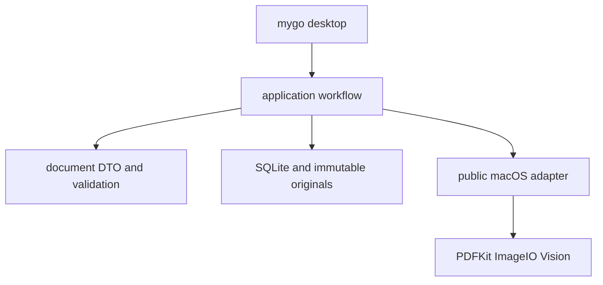
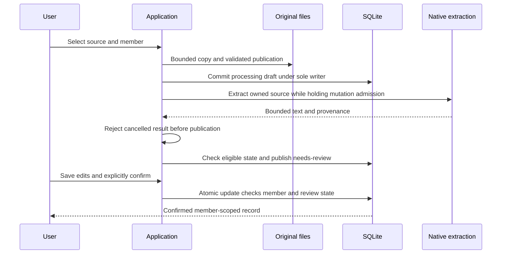
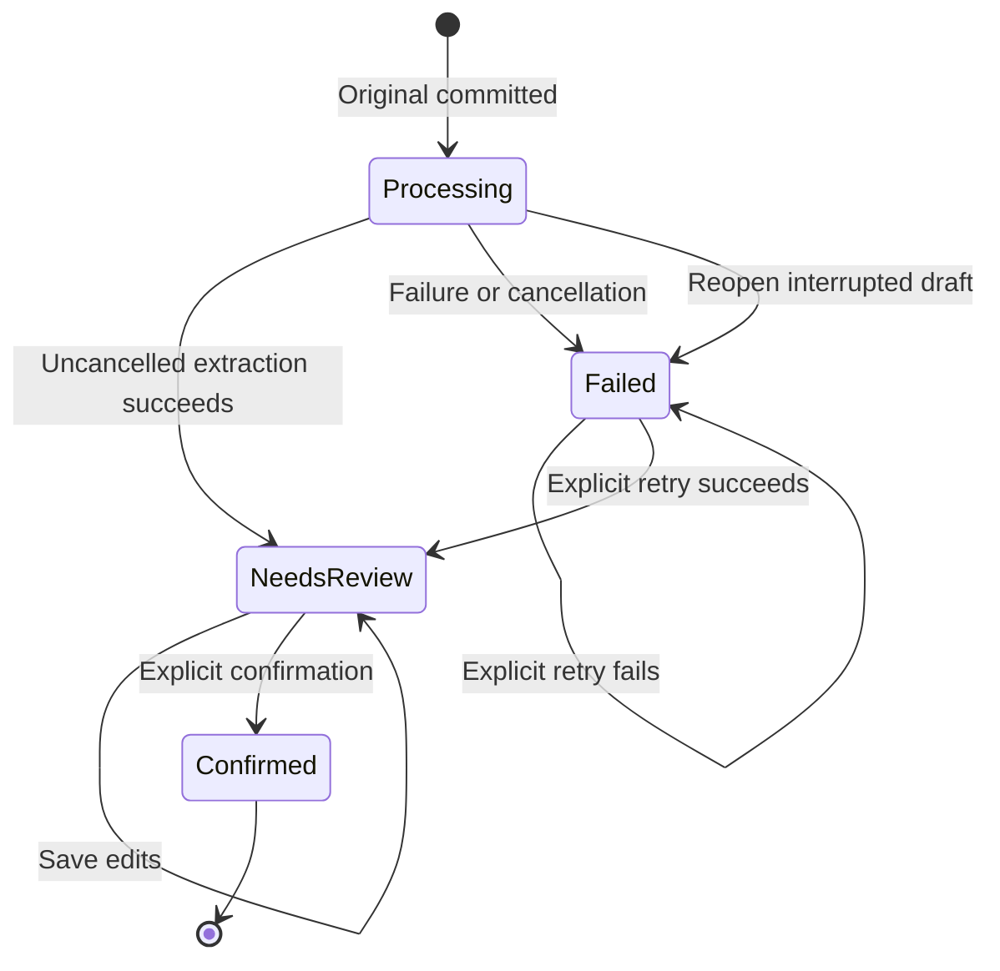

# Go Native Report Workflow - Plan

## Goal Capsule

- **Objective:** 用户能够为家人导入报告，在本机识别、核对并确认文字，重新打开应用后仍能检索记录并回到原件。
- **Means:** Go、mygo native UI、SQLite 和公开 macOS API，见 KTD1–KTD4。
- **Authority:** 用户已批准重新设计，不要求旧数据兼容；产品安全边界仍以 `AGENTS.md`、`PRIVACY.md` 和本计划 R1–R12 为准。代码和可复现结果决定哪些能力已经实现。
- **Execution profile:** 先证明存储确认门和 native OCR，再接通完整界面及独立沙盒预览包；保留 Swift 版本作为可运行对照。
- **Stop conditions:** 需要读取、覆盖或删除旧资料目录，必须改变已批准隐私边界，或公开 API 无法完成本机识别时，暂停相应动作并报告具体证据。不能以 mock OCR、放宽沙盒或引入私有 API 代替验收。
- **Delivery:** 本轮实现首条报告闭环并报告实际验证结果；不提交、不推送、不创建 PR，不把预览阶段描述为完整替换完成。

---

## Product Contract

### Summary

在当前仓库增加独立 Go 应用，首先实现成员、报告导入、本机识别、原件复核、人工确认和查询。新应用使用独立 bundle 与资料目录。LAN、备份、DICOM 和模型功能后续分阶段实现。

### Problem Frame

Kinlogue 尚处测试阶段。用户希望用 Go 统一应用开发，并愿意重新设计存储和模块结构，避免为了旧数据兼容保留实现复杂度。重写的价值取决于报告整理是否仍然可靠、易用，尤其是中文输入、本机识别、来源核对和重启后的持久性。

### Key Decisions

- **不要求旧资料和备份格式兼容。** Governs R1. (session-settled: user-directed — chosen over preserving existing storage compatibility: 应用仍处测试阶段，可以重新设计。)
- **第一阶段继续使用本机 OCR，模型后续加入。** Governs R4, R10. (session-settled: user-approved — chosen over introducing a model provider immediately: 先验证核心闭环，并保留后续识别与整理的扩展边界。)

### Requirements

**Independent preview**

- R1. 新预览版使用与 Swift 版不同的 bundle ID、App 名称和可信 Application Support 子目录；不扫描、迁移、覆盖或删除旧资料。
- R2. 保留当前 `Package.swift`、Swift 源码、测试和打包入口可运行；新增 Go 构建入口及明确的预览能力说明。

**Report workflow**

- R3. 用户能创建和选择家庭成员，通过系统文件面板导入 PDF、JPEG、PNG、HEIC 和单帧 TIFF，原始文件保持不变。
- R4. 识别必须实际调用本机 PDFKit/Vision，并持久化原件、识别结果及来源信息；不把模拟结果作为产品能力。
- R5. 用户可以查看原件、修改标题和转录、选择手工日期或明确“未注明日期”，保存后稍后继续复核；确认前必须指定有效成员。离开有未保存修改的复核页或退出时必须提供保存/放弃/取消选择，保存失败保留当前编辑内容。
- R6. 只有用户明确确认的记录进入该成员的时间线和搜索；草稿和其他成员的内容不能通过查询泄露。
- R7. 重启后保留成员、原件、已保存草稿和确认记录；识别失败仍保留可处理草稿，迟到结果不得覆盖新草稿或已确认内容。
- R8. 原始识别、用户修正和已确认内容保持可区分；每条识别结果保留原件 ID、页码、方法、引擎信息与可用位置，手工输入不得伪造来源。

**Quality and boundaries**

- R9. 导入验证、识别与预览遵守 `docs/import-and-ocr.md` 的输入和输出预算；unsupported、locked、损坏和超限内容给出明确失败类别，不执行附件或发布半份识别结果。
- R10. 本阶段无互联网客户端、网络监听、账号、遥测、模型调用或 Keychain；活动 SQLite 与原件为 App Sandbox 内明文，SHA-256 只用于发现意外损坏，不提供保密、认证或防篡改能力。
- R11. 所有用户可见文案、错误、空状态、确认动作和无障碍标签有简中/英文资源；运行时语言切换不改变用户内容。
- R12. 自动化与预览验收只用合成资料；中文输入法、键盘、VoiceOver 和 macOS 版本兼容性必须分别记录实测与未验证状态。

### Acceptance Examples

- AE1. Covers R3–R8. 为合成成员 A 导入含文字的 PDF，修改转录并保存，重启后继续确认；A 的时间线及搜索显示修正后记录，原件与初始识别结果仍可核对。
- AE2. Covers R6. A 的未确认草稿不出现在搜索中；切换到 B 后，A 的已确认报告也不出现。
- AE3. Covers R4, R7, R9. 合成扫描 PDF 或图片走真实 Vision；超限或损坏文件失败后不产生确认记录，其他原有记录仍可读取。
- AE4. Covers R1, R10. 已安装 Swift 版与新沙盒预览版可以分别启动，预览版只创建自己的资料目录，运行时没有出站网络权限。

### Scope Boundaries

本轮只交付 AE1–AE4 及其必需界面，不宣称达到 Swift 版全部功能。

**Deferred to Follow-Up Work**

- LAN 临时上传、原件 ZIP 导出、加密目录备份及恢复、DICOM 二维查看、并排比较和完整结构化字段复核。
- 大模型文字整理、多模态识别及档案助手。届时需独立定义发送范围、凭据与隐私承诺；模型仍只产生待确认候选。
- 公共分发、Developer ID/notarization、完整 macOS 与真实设备矩阵。

**Considered and not built**

- 通用 Agent 框架、插件系统、远程任务队列和独立服务：首期没有远程或多用户执行需求；出现具体调用方后再评估。
- 旧存储兼容层和自动迁移：R1 明确排除，不以临时转换脚本替代。
- 自制 PDF 或 OCR 引擎：继续使用公开系统框架；只有实际精度或兼容性证据才触发替换调研。

---

## Planning Contract

### Key Technical Decisions

- KTD1. **同仓库独立 Go 模块。** 根目录增加 `go.mod`、`cmd/kinlogue` 和 `internal/`，用独立 worktree/分支开发，Swift 树保持 R2 的对照价值。新建远程项目会拆散产品知识与验收证据，当前没有必要。
- KTD2. **固定依赖版本。** 使用 `github.com/egoist/mygo v0.2.15`、`github.com/ebitengine/purego v0.11.1` 和 `modernc.org/sqlite v1.60.1`；提交可复核 `go.sum`，不追踪浮动分支。mygo native 模式绘制应用界面，系统文件面板通过 macOS 适配提供。此选择允许 Go 实现主体，但不保证 AppKit 控件级交互等效。[mygo 发布](https://github.com/egoist/mygo/releases/tag/v0.2.15)、[SQLite driver](https://pkg.go.dev/modernc.org/sqlite@v1.60.1)
- KTD3. **SQLite 管关系，原件独立保存。** `internal/library` 集中负责 SQL、原件文件和恢复；数据库仅引用应用生成的不透明文件 ID。采用单应用写入所有权和事务，第二实例拒绝打开同一资料库写入口；源文件名只作为数据。SQLite 事务不能原子提交外部文件，因此先写私有临时文件、验证并同步落盘，再发布原件，最后提交引用它的草稿。失败只能留下未引用的应用自有文件，不能留下可见的悬空引用。数据库提交结果不确定时先保留原件，重新确认数据库权威状态后才允许清理；不得把提交报错等同于“肯定未提交”。
- KTD4. **公开 macOS API 的小范围 Go 适配。** `internal/macos` 用 purego 调用 Foundation、PDFKit、ImageIO 与 Vision，不引入生产 Swift helper。遵守线程及 autorelease pool 所有权，逐页/逐图解码，及时释放 native 对象。适配负责可信运行目录、系统选取与临时文件授权、输入探测、文本提取和有界预览。(session-settled: user-approved — chosen over replacing the OCR engine during rewrite: 延续现有系统识别路径便于比较效果。) Governs R4, R9.
- KTD5. **单一写入所有者与串行应用动作。** `internal/document` 定义跨包数据；`internal/app` 的唯一 Service 协调导入、识别、保存和确认；`internal/desktop` 只渲染状态与发送动作。资料库生命周期独占锁阻止第二实例写入，Service 的可取消准入将每个修改动作串行执行到底，包含 native OCR 返回、结果检查与失败收尾。Store 在同一互斥临界区内核对持久状态并写入：只有没有识别结果的 processing/failed 草稿接受首次提取，只有 review 接受修正或确认。UI 在动作期间禁用编辑与导航，以 job generation 丢弃过期显示回调，更新回到主线程。退出时先停止准入并取消动作，再等待已进入动作结束后关闭资料库。此范围没有并行编辑者或识别 attempt，因此采用序列化和条件状态更新即可满足 R7，不增加持久 revision/attempt 字段；以后引入第二编辑入口或同一草稿的并行识别前必须重新设计冲突检测。
- KTD6. **保留候选与确认边界，暂不设计模型运行时。** 识别返回文字、页码、位置和引擎信息；用户修正存为独立内容，确认提交同一事务内的状态变化。后续模型适配可以产生相同候选结果，但不能获得绕过 R6/R8 的数据库入口。
- KTD7. **有界 native 处理与可恢复失败。** 输入先复制到自有 staging 再探测处理，regular-file/no-follow 校验与流式字节上限防止路径和增长文件问题。以 R9 指定预算作为共享常量；PDF 按页持有最大长边 2,400 pixels 的渲染，图像预览同样有界，OCR 总预算超限全部失败。预览使用按页加载及受限缓存，不为整份 PDF 建立全页位图。

### High-Level Technical Design







图中的状态为持久草稿状态。显式重试在操作期间仍保持 failed，界面以独立 busy 状态显示处理进度；没有成功结果就不会进入 review。重开时将中断的 processing 转为可重试失败，不自动重启识别。任务取消后仍保留修改准入，等待 native 调用返回并拒绝迟到成功，收尾结束后才允许下一动作进入。

### Output Structure

```text
cmd/kinlogue/main.go
internal/document/
internal/library/
internal/macos/
internal/app/
internal/desktop/
packaging/go-preview/
scripts/build-go-preview.sh
scripts/verify-go-preview.sh
docs/go-native-preview.md
```

### Assumptions

- 首条闭环每次导入一个文件作为一份报告；多文件组合、识别日期候选分类及原有结构化字段范围后续扩展。此范围是分阶段交付假设，不代表取消最终功能目标。
- 首期使用普通参数化 SQLite 查询支持中英文已确认转录检索；不预先引入 FTS 分词方案。查询对中文提供子串匹配，只检索当前已确认修正文案，原始 OCR 中已被修正掉的词不再命中。
- macOS 14 为目标最低系统，当前 Mac 的构建与运行只能证明当前环境；mygo 在最低系统上的输入、绘制和系统调用兼容性留待矩阵验证。
- 首期 App 关闭后中断的识别可由用户显式重试；不会自动改写已有识别结果。
- 重复导入在首期创建独立草稿并独立保存 UUID 原件，不进行内容去重或自动合并。未来如引入原件字节复用，必须先验证现有原件完整性，并保留成员归属的独立性。

### Risks and Dependencies

mygo 的自绘输入、可访问性与系统 native bridge 是主要风险。通过真实合成扫描件、文件面板授权和已签名沙盒 App 闭环验证它们；若出现框架缺口，报告具体操作与失败结果，不用 headless 单测替代人工门禁。

系统解码 API 不提供本计划可证明的硬内存隔离。R9/KTD7 的预检、顺序处理和尺寸预算能限制正常处理资源；恶意构造文件导致的 native 解码风险必须保留为限制。独立 decoder 进程仅在后续证据要求时设计，不能在当前版本宣称已具备。

现有 Swift 知识库描述的“当前能力”继续指 Swift 基线。新增预览文档必须显式列出已实现子集，不能将整个 Wiki 改写为 Go 版本已经具有全部 LAN/备份/DICOM 功能。

---

## Implementation Units

### U1. Module and shared contracts

**Goal:** 建立可构建 Go 入口、依赖锁定和跨包数据约定。

**Requirements:** R1, R2, R8, R10. **Dependencies:** 无。

**Files:** `go.mod`、`go.sum`、`cmd/kinlogue/main.go`、`internal/document/document.go`、`internal/document/document_test.go`。

**Approach:** 按 KTD1/KTD2 声明依赖，按 KTD6 定义成员、草稿、确认记录与来源 DTO；不引入抽象仓储框架或通用任务引擎。

**Execution note:** 先确定跨包 contract 及状态验证，保证后续包能独立开发。

**Test scenarios:**

1. 非法日期、空成员归属和无效状态转移被拒绝，合法手工日期与 unknown 可区分。
2. OCR 原始文字与用户修正序列化后仍可区分。

**Verification:** Go module 能以固定依赖构建；共享包不依赖 UI 或 native 实现。

### U2. Library persistence and confirmation gate

**Goal:** 让成员、原件和草稿可靠落盘，并严格限制确认后的查询。

**Requirements:** R3, R5–R8, R10. **Dependencies:** U1。

**Files:** `internal/library/library.go`、`internal/library/schema.go`、`internal/library/library_test.go`。

**Approach:** 按 KTD3 集中原件和 SQLite 生命周期，按 KTD5 实现条件更新。原件读取复核长度及摘要；临时文件清理只操作可证明由当前应用创建的文件。

**Patterns to follow:** `Sources/KinloguePlatform/Storage/` 的对象先行发布原则；`docs/storage.md` 的不完整发布与恢复边界。

**Execution note:** 先写临时目录上的真实 SQLite 集成测试，再实现持久化。

**Test scenarios:**

1. Covers AE1. 创建成员、导入合成原件、保存修正、关闭重开后内容与原始字节一致。
2. Covers AE2. 未确认草稿、另一成员记录均不进入所选成员搜索和时间线；中文子串可以命中修正文本，修正掉的 OCR 词不能命中。
3. 空/无效成员或非 review 状态不能确认；已确认记录的重复提交不生成重复记录，且首次识别不能覆盖 review/confirmed 内容。
4. 原件发布后 SQL 失败或中途终止，不产生悬空引用；重开不导入未引用文件。
5. 第二实例不能写同一库；首实例正常结束后可以重新打开。
6. 同一文件导入到两个成员时各自保存原件与草稿；确认其中一个不会暴露另一个，已有损坏副本不会导致新导入的完好字节被丢弃。

**Verification:** 真实库重开、确认门、成员隔离、写入所有权与失败注入用例通过。

### U3. Native extraction and preview

**Goal:** 通过公开系统 API 提取合成 PDF 和图片文字并呈现来源原件。

**Requirements:** R3, R4, R8–R10. **Dependencies:** U1。

**Files:** `internal/macos/bridge_darwin.go`、`internal/macos/extraction_darwin.go`、`internal/macos/runtime_darwin.go`、`internal/macos/extraction_darwin_test.go`。

**Approach:** 按 KTD4/KTD7 实现 panel、受限文件探测、PDF text layer 与扫描页 Vision 路径、ImageIO orientation 和预览。优先沿用 `docs/import-and-ocr.md` 的 Vision revision 3、accurate、zh-Hans/en-US、关闭 language correction；发现平台不支持时返回明确错误或经记录的语言降级，不静默改写来源。

**Patterns to follow:** `Sources/KinloguePlatform/OCR/VisionTextRecognizer.swift`、`Sources/KinlogueApp/Views/OriginalDocumentPDFRenderer.swift` 及其现有测试。

**Execution note:** 先证明真实系统桥接能识别合成 PDF 和图像，再接入 UI。

**Test scenarios:**

1. Covers AE3. 合成 text-layer PDF 保留页码和提取方法；扫描 PDF 与图片通过实际 Vision 得到稳定 anchor。
2. EXIF orientation 下文字与预览方向一致，坐标有效；断言来源与顺序，不比较整段 OCR 精确快照。
3. locked/损坏 PDF、多帧图片及 R9 任一预算超限给出完整失败，无部分成功。
4. 页切换只保留有限 native buffer；取消后的结果无法发布给过期调用方。

**Verification:** 原生测试证明 PDFKit、ImageIO 和 Vision 真正参与，无生产 Swift helper，无联网依赖。

### U4. Workflow and native desktop

**Goal:** 用户可以完成成员创建、导入、复核、确认、搜索与回看原件。

**Requirements:** R3–R8, R11, R12. **Dependencies:** U1, U2, U3。

**Files:** `internal/app/app.go`、`internal/app/app_test.go`、`internal/desktop/desktop.go`、`internal/desktop/strings.go`、`internal/desktop/desktop_test.go`。

**Approach:** 按 KTD5 连接应用动作与持久化结果，界面提供成员选择、草稿列表、原件页预览、标题/日期/转录编辑、保存/确认、时间线与搜索。复核页与已确认记录详情保留初始识别的只读查看入口，与用户修正转录明确区分，落实 AE1/R8 的来源核对。持久错误保存语义 key；所有 busy、empty、error 和确认文案由中英资源解析。

**Patterns to follow:** `docs/design-system.md`、`docs/localization.md` 的视觉、错误状态和运行时切换原则；Go 资源不假冒已通过 Swift String Catalog 门禁。

**Test scenarios:**

1. Covers AE1, AE2. 使用真实 library 的应用测试覆盖保存、重开、确认、搜索和成员切换；对已修正报告验证保存、重开及确认后仍能查看初始识别，且只读入口不会覆盖修正文案。
2. 已取消但稍后返回成功的 OCR 不能发布结果；处理结束前排队的修改不能进入。Save/Confirm 期间禁止继续编辑，旧选择的 preview 不能覆盖当前原件；切换草稿、成员或关闭窗口时，未保存编辑由 R5 的明确选择保护。
3. 识别失败、取消和文件 panel 取消均返回可继续操作状态。
4. 中英文 key 集合相同；语言切换重新解析已有错误，不改写报告内容。
5. mygo headless 测试在可用时验证主要控件、动作与空状态；中文 IME 和 VoiceOver 单列人工验证。

**Verification:** 完整 UI 链路可以在本机操作，测试与人工证据分别报告。

### U5. Sandboxed preview and documentation

**Goal:** 提供不会访问旧资料的可启动预览包及清楚的运行和验证说明。

**Requirements:** R1, R2, R9–R12. **Dependencies:** U4。

**Files:** `packaging/go-preview/Info.plist`、`packaging/go-preview/Entitlements.plist`、`scripts/build-go-preview.sh`、`scripts/verify-go-preview.sh`、`docs/go-native-preview.md`、`docs/index.md`、`docs/log.md`、`README.md`。

**Approach:** 为预览单独签名、标识和打包，运行目录由系统可信 API 提供。entitlements 只包含沙盒和需要的用户选择文件读取能力；不用网络权限。文档按照实际结果注明 Swift 基线与 Go 子集。

**Execution note:** 打包配置用签名/entitlement 检查和安装后 runtime smoke 验证，不为静态配置写镜像式测试。

**Test scenarios:**

1. Covers AE4. 从预览 bundle 启动并执行合成资料闭环，运行路径位于预览容器。
2. panel 选择仓库外合成文件可导入；取消选择不会产生草稿。
3. 签名与精确 entitlement allow-list 检查通过，包中无真实资料、开发源路径或临时夹具。
4. 现有文档链接门禁与隐私门禁通过；现有 Swift 构建入口不被 Go 脚本替换。

**Verification:** 可复现预览 bundle 与当前 Mac 的 smoke 证据齐备；未执行门禁明确列出。

---

## Verification Contract

| 范围 | 验证入口 | 通过条件 | 适用单元 |
| --- | --- | --- | --- |
| Go 行为 | `go test ./...` | storage、应用与文案测试通过；native case 未执行须显式报告 | U1–U4 |
| 并发 | `go test -race ./internal/library ./internal/app` | 数据竞争与条件写入测试通过；工具链限制另记 | U2, U4 |
| Go 静态构建 | `go build ./cmd/kinlogue`、`go vet ./...` | 构建与检查无未解释错误 | U1–U4 |
| 预览 bundle | `scripts/build-go-preview.sh`、`scripts/verify-go-preview.sh` | 独立身份、签名、沙盒权限与运行路径符合 R1/R10 | U5 |
| 仓库门禁 | `scripts/privacy-guard.sh`、`scripts/verify-docs.sh` | 无真实资料或断链；Go 扫描边界单独核对 | U5 |
| Swift 基线 | `swift build --disable-sandbox` | 保留基线构建；完整历史测试是否执行单列 | U5 |
| 人工 | 合成报告 UI 闭环、中文 IME、键盘、VoiceOver | 每项记录 passed/pendingManual/notExecuted/blocked 及环境 | U4, U5 |

计划本身不记录执行结果。实现完成后的 `docs/log.md` 和预览说明记录命令、环境与限制；不能把当前 Mac 通过写成 macOS 14 或正式发布兼容性通过。

---

## Definition of Done

- U1–U5 已形成可运行报告闭环，R1–R12 的实现证据与限制可核对。
- 草稿保存/重开、确认门、成员隔离、真实 OCR、来源预览和沙盒独立目录均有自动化或明确 runtime 验证。
- 原件与识别修正的来源关系未丢失，失败不会使已有确认记录不可读取。
- Go 预览新增文案同时提供中英资源，中文输入及无障碍未测项目保持可见。
- 文档索引可达、日志追加，保留 Swift 当前事实与 Go 未实现功能的区别。
- 删除无用实验代码和依赖；没有真实资料、临时输出、构建包或本机报告进入待提交文件。

---

## Appendix

### Sources and Research

- `docs/project-overview.md`、`docs/import-and-ocr.md`、`docs/storage.md`：核心用户闭环、资源边界和来源确认规则。
- `README.md`、`PRIVACY.md`：当前 Swift 用户承诺；Go 预览必须明确单列范围。
- `docs/testing-and-release.md`、`docs/localization.md`：证据分类、本机与公开验收边界、中英资源要求。
- [mygo v0.2.15 release](https://github.com/egoist/mygo/releases/tag/v0.2.15)：固定 native UI 框架；release 指向 `da84fc5`，不能与先前调研的 main commit 混写。
- [purego v0.11.1](https://pkg.go.dev/github.com/ebitengine/purego@v0.11.1)：公开系统 API 的 Go 调用边界。
- [modernc SQLite v1.60.1](https://pkg.go.dev/modernc.org/sqlite@v1.60.1)：固定无 cgo SQLite driver。
- [Apple Vision text recognition](https://developer.apple.com/documentation/vision/vnrecognizetextrequest)：实际识别桥接参考；版本精度与语言支持仍须运行验证。
