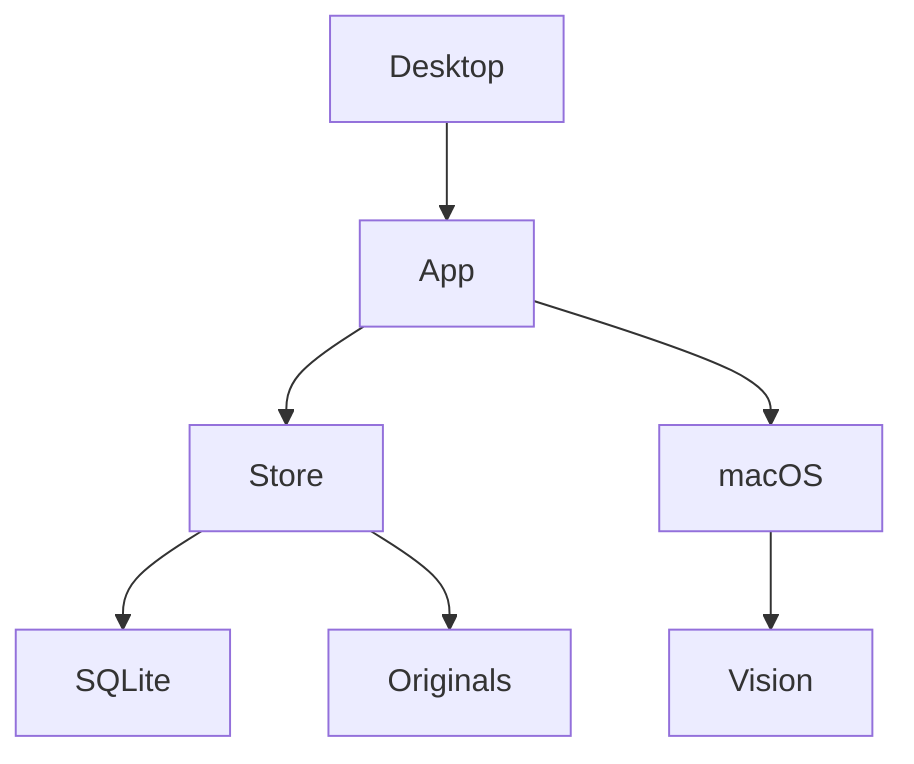
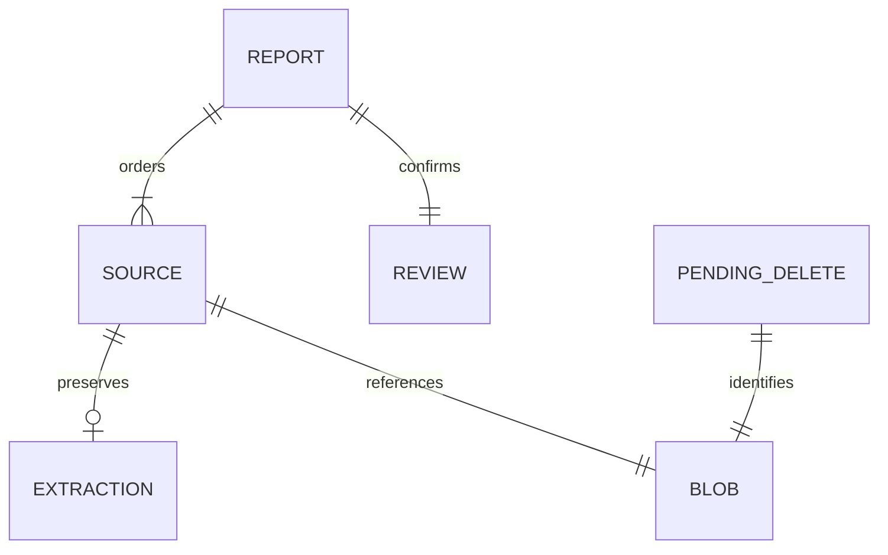
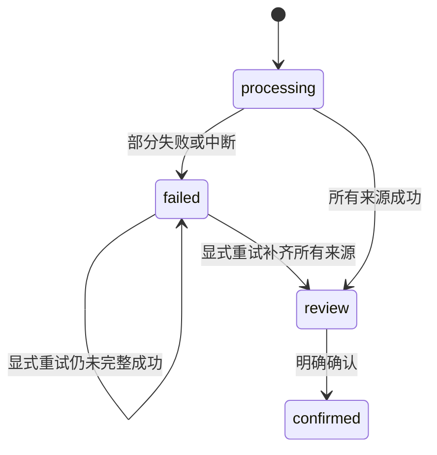
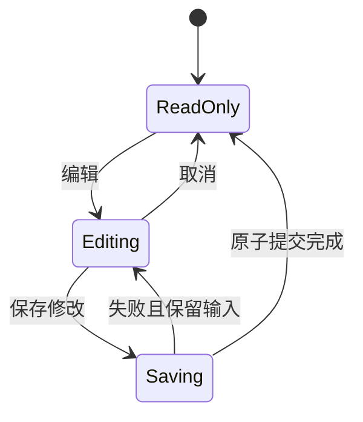
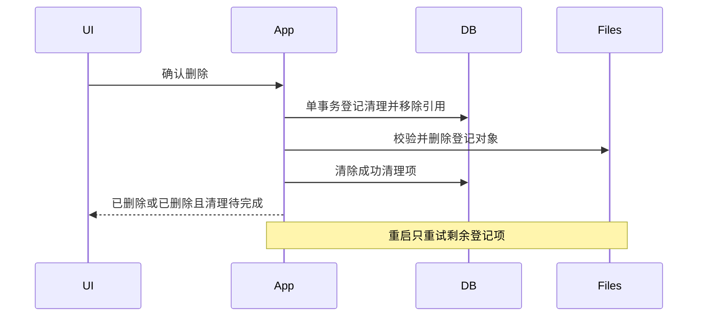
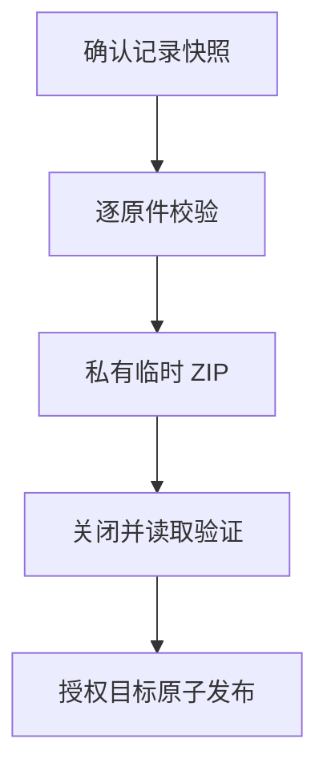
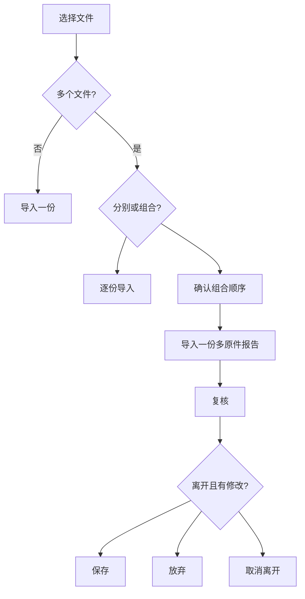

# Go Daily Report Workflow - Plan

## Goal Capsule

- **Objective:** 用户能把一份多页报告整理成一条可核对的记录，发现错误后修正，并按需要删除或带走原件。
- **Means:** 延续独立 Go 预览的 Store、App、Desktop 分层，扩展多原件资料格式和日常操作，见 KTD1–KTD7。
- **Authority:** 当前用户授权、`AGENTS.md`、真实代码与可复现结果优先；本计划继承[首阶段计划](2026-10-07-0812-feat-go-native-report-workflow-plan.md)的本机、人工确认和来源边界。
- **Execution profile:** 行为先有针对性测试；存储和生命周期必须有真实跨层验证，键盘与输入法以真实窗口验收补足。
- **Stop conditions:** 发现迁移会损坏现有 Go 库、需要私有系统 API，或必须扩大用户资料披露范围时，停止相关改动并报告事实。
- **Delivery:** 实现、验证和文档在现有 Go worktree 完成；不提交、不推送、不创建 PR。执行方保留 Swift 基线和原工作区改动。

---

## Product Contract

### Summary

将 Go 预览推进到可完成日常报告整理的阶段：补齐中文输入与键盘操作、多原件组合及排序、确认后纠错、删除清理和单条报告原件 ZIP 导出，并建立独立 Go CI。

### Problem Frame

首阶段已经能导入、识别、复核和搜索，但每个文件只能生成独立报告，确认后不能纠错，删除草稿仍保留原件文件。手机拍照的一份报告可能有多个文件；仅有一次确认流程不足以支持后续整理。

mygo 使用自绘控件，中文粘贴成功不能证明输入法预编辑、焦点和键盘路径可用。继续扩展功能之前，需要验证这些基础交互，并修复能够重现的缺陷。

### Requirements

**Input and navigation**

- R1. 中文输入法的预编辑、提交和取消不得丢失原字段内容；标题、转录和备注都能完成实际输入。
- R2. 常用编辑快捷键、Tab 焦点和报告列表键盘选择具有可预测结果，且关闭窗口仍遵守未保存修改与后台任务退出规则。

**Reports and sources**

- R3. 多选导入明确区分“分别成为报告”和“合为一份报告”，组合后的原件顺序由用户决定。
- R4. 一份报告保留有序、不可变的原件及各原件的初始识别；预览和来源转录定位到具体原件的本地页码。
- R5. 识别部分失败时保留已复制原件和已成功识别，允许显式重试；未完整成功的报告不能确认或进入搜索。
- R6. 用户能在复核时及确认后的编辑状态调整原件顺序，排序不会重写原件、初始识别或已有人工修正。

**Correction and removal**

- R7. 已确认记录通过明确的“编辑”和“保存修改”更新；保存前旧确认内容继续可查询，取消编辑不修改持久内容。
- R8. 修改成员、日期、标题、转录、备注和原件顺序作为一个完整修改提交；搜索和成员归属只显示完整旧状态或完整新状态。
- R9. 删除前显示范围并明确确认，删除已确认报告和草稿只移除 App 管理的副本。
- R10. 删除事务完成后记录立即从界面和查询消失；若原件清理尚未完成，界面如实提示并在重启后继续安全清理。

**Export and preservation**

- R11. 用户能从一条已确认报告导出其全部原件为明文 ZIP；导出不包含 OCR、转录、备注、数据库或其他报告。
- R12. 导出必须先说明明文副本和非备份边界，保存位置由系统面板选择；取消、损坏和写入失败不能被报告为成功或破坏原有目标文件。
- R13. 当前 Go v1 测试资料库无损升级到新格式，保留报告身份、成员、语言、原件字节和已确认内容；不读取或迁移 Swift Vault。
- R14. Go 测试、静态检查、资源与签名门禁有独立 CI 入口，既有 Swift workflow 保持原行为。
- R15. 新增界面、错误、确认框和无障碍名称使用中英文语义资源；只使用合成数据验证和记录证据。

### Key Decisions

- **继续独立 Go 重写。** 沿用已可运行的隔离预览，保留 Swift 作功能对照。Governs R13, R14。 (session-settled: user-approved — chosen over replacing the Swift checkout: preserve a working baseline while validating Go)
- **先完成日常报告操作。** 用户已接受先处理输入、原件关系、纠错、删除和导出，再做备份恢复。Governs R1–R12。

### Scope Boundaries

本轮不新增项目、分支、账号、网络客户端、遥测或外部识别服务。

#### Deferred to Follow-Up Work

- 备份恢复、LAN、DICOM、结构化医学字段、比较和大模型。
- 向既有报告追加或移除单个原件、拆分和跨报告合并；本轮先解决导入时组报告和组内排序。
- 多报告批量导出和成员生命周期管理；本轮导出一条已确认报告的全部原件。

#### Considered and Not Built

- 通用迁移框架和事件日志：目前仅有一个已知 v1→v2 转换，单个事务足以覆盖它；未来出现独立版本链再评估。
- 任意孤儿文件扫描回收：旧版本可能留下无法证明归属的 blob，本轮只清理由删除事务明确登记的对象。
- 安全擦除、系统快照删除和外部副本撤回：App 无法证明这些结果，不提供相应承诺。
- OCR 子进程或强制中断：保留当前公开 API 的进程内能力边界，原生调用可能等待返回；本轮不扩展为隔离服务。

### Acceptance Examples

- AE1. Covers R3–R6. 两张合成图片合为一份报告后，以第二张在前的顺序保存并重启；预览顺序正确，初始识别仍指向各自第 1 页。
- AE2. Covers R7, R8. 已确认报告从成员 A 修改为成员 B，取消后 A 的旧内容不变；明确保存后仅 B 能查到新内容。
- AE3. Covers R9, R10. 删除多原件报告在数据库提交后被终止；重启不恢复报告，并继续清理登记的原件，不触及其他报告。
- AE4. Covers R11, R12. 导出 AE1 的确认记录，ZIP 解包后原件字节与导入前一致，条目顺序对应保存顺序，且没有候选或人工文字文件。
- AE5. Covers R13. 含 review、failed、confirmed 和成员的合成 v1 库升级后全部可继续使用；中断升级后能重新打开为完整 v1 或 v2。

---

## Planning Contract

### Current Evidence

- `internal/library/store.go` 的 v1 `reports` 行同时保存报告、识别和单份 blob 的摘要；`ReadOriginal` 以报告 ID 定位原件。
- `SaveReview` 和 `Confirm` 只接受 `review`；`DeleteDraft` 拒绝 confirmed，且有意不清理 blob。
- `internal/app/service.go` 的 `command` 串行化修改并登记退出中的操作；`Close` 停止新任务后等待原生调用退出。
- `internal/desktop/desktop.go` 的 dirty guard、job/preview generation 和单预览队列已有覆盖；需将 source 身份和确认后编辑纳入同一边界。
- `internal/desktop/view.go` 的列表已虚拟化，Store 列表只读元数据；新增关系不能把原件或完整 OCR 带回列表加载。
- `packaging/go-preview/Entitlements.plist` 目前仅有沙盒与用户选择文件只读能力；导出需要同步精确授权、验证脚本和隐私说明。

### Assumptions

- 本轮先允许每报告最多 20 个原件，总计 200 页和 1 MiB 初始候选文字（含拼接分隔符）；单原件继续使用 `internal/document` 既有上限。这是防止多原件放大内存与识别成本的工程上限，不是长期产品上限。
- 确认后编辑在当前窗口内保持未保存草稿，不新增持久的第二份编辑版本；离开时的保存、放弃、取消提示承担未保存保护。
- 同一 PDF 内部页序保持不变；排序单位是原件文件。单页照片的排序同时就是其报告页序。

### Key Technical Decisions

- KTD1. **报告与原件分表。** `Report.Sources` 保存有序 `Source`，每份来源持有 ID、展示名和 `Extraction`；报告保留独立 `Review`。移除报告级 `Extraction`，保留 `FileName` 作为列表展示投影，避免两套来源权威。Governs R4, R6。
- KTD2. **已知 v1 事务升级。** 在当前单 owner 锁及 SQLite 持久化配置下，将每条 v1 报告转为一个 source，复用原 blob ID 和字节，不改写内容。表变更、数据迁移与版本号同事务提交；未知版本或损坏库拒绝升级。依据 [SQLite 事务保证](https://www.sqlite.org/transactional.html)。Governs R13。
- KTD3. **逐件读取、逐件识别。** `CreateDraftSources` 接收有序展示名和按索引读取回调，每次只保留一个原件字节缓冲。全部原件可靠发布后才发布报告关系；成功识别逐 source 保存，重试只处理缺失识别，最后一次完成才生成初始 `Review.Text`。复制或关系提交失败沿用首阶段保守策略，可能留下未引用原件；不将这些文件冒充可由报告删除清理的对象，文档保留此边界。Governs R3–R5。
- KTD4. **修改提交携带全排列。** `Edit.SourceIDs` 必须是当前 sources 的完整且无重复排列；文本与顺序在 `SaveReview`、`Confirm` 或独立 `UpdateConfirmed` 中一次提交。后者仅接受 confirmed。排序不触发重新 OCR。Governs R6–R8。
- KTD5. **数据库先取消引用，再按清单清理。** `DeleteReport` 事务写入待清理来源 ID、摘要和长度，并移除报告及关系；提交后仅清理无引用且身份、权限和字节验证匹配的私有普通文件。成功后持久化目录变更并清除清单。返回 `DeleteResult.CleanupPending` 区分“记录已删除但清理待完成”，重启复用同一清理路径。Governs R9, R10。
- KTD6. **导出一个快照。** App 串行命令读取已确认记录，以 `archive/zip` 逐原件写入有序、生成式条目名；扩展名取已验证内容类型，不拼接展示名。完成 ZIP 关闭和完整读取验证后才发布。系统保存授权与文件发布留在 macOS 适配层，界面不直接访问库文件。依据 [Go ZIP API](https://pkg.go.dev/archive/zip) 和 [Apple 用户选择读写授权](https://developer.apple.com/documentation/bundleresources/entitlements/com.apple.security.files.user-selected.read-write)。Governs R11, R12。
- KTD7. **扩展现有生命周期与资源门禁。** 新任务全部进入 `command`、UI generation 和退出协调；不引入第二后台队列。打包使用精确 user-selected.read-write 取代 read-only，并区分旧包替换资格与新包精确验证。独立 Go workflow 使用已固定 Go 版本和 action commit。Governs R2, R12, R14, R15。

### API Boundaries

下表约束跨模块语义，不规定内部 SQL 和辅助函数的实现。

| 模块入口 | 输入与结果 | 状态约束 |
| --- | --- | --- |
| Store `CreateDraftSources` | 有序 names、逐索引 read 回调 → Report | 原件全部可靠保存后才发布关系；无效数量或读取失败不发布部分报告 |
| Store `SaveSourceExtraction` | report ID、source ID、Extraction → Report | source 必须属于该报告；已成功识别不可覆盖 |
| Store `ReadOriginal` | report ID、source ID → 字节 | 同时校验归属、摘要、长度和私有文件身份 |
| Store `SaveReview` / `Confirm` | report ID、Edit → Report | Edit 含 SourceIDs；首次确认仍要求成员和标题 |
| Store `UpdateConfirmed` | report ID、Edit → Report | 单次显式保存；验证等同确认，并保持 confirmed |
| Store `DeleteReport` | report ID → DeleteResult | CleanupPending 表示已提交删除后仍需物理清理 |
| App `Import` / `ImportMany` | 单路径 / 有序路径列表 → Report | 分别导入使用 Import；组合调用 ImportMany，不自动按内容合并 |
| App `Preview` | report ID、source ID、本地 page → 图像 | 失败原件仍可尝试第 1 页，实际格式和页数由原生适配核实 |
| App `ExportOriginals` | 当前 confirmed report ID、系统授权目标路径 | 通过注入的 macOS `WriteExport` 和 writer 回调流式生成 ZIP；界面不直接发布文件，不整份缓存 ZIP |
| Desktop edit state | Edit、source ID、本地 page | 比较 SourceIDs 的元素顺序判断 dirty；重排后保持 source 身份选中 |

### High-Level Technical Design

模块关系：

资料关系：

识别状态：

重试期间数据库保留 `failed`，界面另行显示忙碌状态；全部来源完成后直接进入 `review`，不新增持久化的重试中状态。

确认后纠错：

删除提交与恢复：

导出数据流：

多选与离开决策：

### System-Wide Impact

`Report` 和 `Edit` 的变化影响 Store、App、Desktop 及其 fake Backend，必须同一逻辑单元收敛。`Edit` 新增 slice 后不能继续使用结构体直接比较，编辑快照和保存基线必须复制 SourceIDs，避免取消编辑仍改动基线。预览缓存和迟到结果要纳入 source ID，否则重排可能显示另一份原件的图像或文字。

升级后的库不能由旧 Go v1 二进制打开。新版本保持未知格式拒绝逻辑；不能把拒绝当损坏并重新初始化。

导出增加用户选择目标的写权限，需同步打包脚本、entitlement 精确门禁和隐私文档。构建脚本当前重置 PATH，CI 的 setup-go 安装路径不能默认视作有效；必须验证解析到固定版本的工具链。

### Sequencing

U1 输入审计、U2 存储和 U6 CI 可并行。U3 依赖 U2；U4 依赖 U2 和 U3；U5 汇合 U1–U4。U7 在这些单元完成后提供完整签名应用验收和文档事实。

---

## Implementation Units

### U1. Input and keyboard correctness

**Goal:** 让现有编辑与选择路径可靠承载 R1、R2、R15。

**Dependencies:** 无。

**Files:** `internal/desktop/desktop.go`、`internal/desktop/view.go`、`internal/desktop/strings.go`、`internal/desktop/desktop_test.go`、`third_party/mygo/`、`go.mod`、`go.sum` 与打包许可证。

**Approach:** 对已定位的 mygo composition 取消丢失选中文本问题保留最小本地补丁，固定来源为 v0.2.15、commit 前缀 `da84fc54`，以 `third_party/mygo` replace 接入并保留上游许可、embed 与跨平台测试。应用层没有可完整恢复选区的公开 hook，因此不改模块缓存，也不引入远程 fork。列表显式接入 Selected/Submitted；菜单与焦点不靠只读 AX 文本推断。

**Patterns to follow:** 既有 UI headless 测试、dirty guard、语言 key 与 job completion 围栏。

**Test scenarios:**

1. 选中已有中文后进入输入法预编辑并取消，原文和选区恢复；提交只替换一次。
2. 标题、转录和备注分别验证撤销、重做、复制、粘贴及全选；输入中的 Return 不误确认报告。
3. 列表上下键改变选择，Return 打开所选记录；焦点进入输入框时方向键不移动列表。
4. Dirty 记录切换、窗口关闭与忙碌任务退出继续遵守已有保存/放弃/取消行为。

**Verification:** 合成内容的自动化回归与真实窗口结果分别记录；未具备环境的输入法或 VoiceOver 检查明确列为未执行。

### U2. Ordered source storage and migration

**Goal:** 落实 R4–R6、R8、R13 的数据合同。

**Dependencies:** 无。

**Files:** `internal/library/store.go`、`internal/library/store_test.go`、`internal/library/recovery_test.go`、新增 `internal/library/migration_test.go`、`internal/document/document.go`、`internal/document/document_test.go`。

**Approach:** 依 KTD1–KTD4 建立来源关系、已知 v1 迁移和全排列更新。保留列表 metadata projection、单 owner 锁、原件先于引用发布及首次初始化恢复规则。

**Execution note:** 先构建合成 v1 数据和迁移中断证据，再改变 `Open` 的版本分支。

**Test scenarios:**

1. Covers AE5. v1 全状态库升级保留每个字段、来源识别和原件 hash；重复打开不重复迁移。
2. 在迁移事务提交前后强制退出，重启得到完整 v1 或 v2；未知版本和损坏表结构不被覆盖。
3. 20 原件成功，空组和超限组拒绝；第 N 次 read/write 失败不发布部分报告。
4. 重复、缺失或跨报告 SourceIDs 拒绝，合法重排与文本原子保存。
5. 列表仍不加载 sources/OCR/正文；完整详情以 `Get` 读取。

**Verification:** 存储单元、真实重启与 race 覆盖通过，已有首次初始化恢复和私有路径门禁保持成立。

### U3. Multi-source recognition and confirmed correction

**Goal:** 将 R3–R8 接入真实 App 用例。

**Dependencies:** U2。

**Files:** `internal/app/service.go`、`internal/app/service_test.go`、`internal/app/native_integration_darwin_test.go`、`cmd/kinlogue/main.go`。

**Approach:** 依 API Boundaries 更新 Import、ImportMany、Preview、Retry 和 UpdateConfirmed；使用 KTD3、KTD4、KTD7 的单队列与状态约束。

**Patterns to follow:** `command`、现有识别失败清理和 `Close` 等待已进入任务。

**Test scenarios:**

1. Covers AE1. 图片与两页 PDF 组合识别，每个 OCR block 仍引用自己的本地页。
2. 第二来源失败后第一次成功结果不被 Retry 覆写；重试完成后只初始化一次 Review.Text，包括识别已齐全但报告尚未推进的恢复状态。
3. 总页数或文字超限时整份报告不可确认；保存的原件可显式删除。
4. Covers AE2. confirmed 编辑保存与取消在真实 Store 上验证成员和搜索结果；OCR 永远不写入确认修改。
5. ImportMany、Preview 与 Close 交错，取消不发布迟到结果，也不在 SQLite 关闭后写入。

**Verification:** Fake processor 行为测试和实际 PDFKit/Vision 跨层合成测试均覆盖多 source 定位。

### U4. Delete cleanup and original export

**Goal:** 完成 R9–R12 的资料退出路径。

**Dependencies:** U2, U3。

**Files:** `internal/library/store.go`、新增 `internal/library/delete_test.go`、`internal/library/recovery_test.go`、`internal/app/service.go`、新增 `internal/app/export_test.go`、`internal/macos/files_darwin.go`、`internal/macos/unsupported.go`、相应文件发布测试。

**Approach:** 依 KTD5 完成 durable cleanup；依 KTD6 提供单条 confirmed ZIP。导出进行期间进入 App 操作登记，并与修改/删除保持一致快照。

**Test scenarios:**

1. Covers AE3. 删除在事务前、提交后、首文件删除后终止，重启不误恢复记录或删除无关文件。
2. 待清理对象缺失可收敛；被替换、symlink、仍被引用或 hash 不符时不删除，并返回待清理状态。
3. Covers AE4. 重名、路径分隔符、非 ASCII 展示名不会形成危险 ZIP 路径；全部原件 hash 与导入一致。
4. 草稿导出拒绝；OCR、备注、成员名与数据库不出现在 ZIP 条目或额外 manifest。
5. ZIP Close、目标写入、原件完整性验证失败及取消均保留既有目标；成功发布后才给出成功状态。
6. 导出与退出、删除交错，不产生已删除记录的迟到确认，也不关闭仍使用中的 Store。

**Verification:** 真实临时文件、SQLite 和 ZIP 解包验证通过；系统保存面板写权限由签名应用验收。

### U5. Daily workflow UI

**Goal:** 将 R3、R6–R12、R15 变成完整可见操作。

**Dependencies:** U1–U4。

**Files:** `internal/desktop/desktop.go`、`internal/desktop/view.go`、`internal/desktop/strings.go`、`internal/desktop/desktop_test.go`。

**Approach:** 增加多选导入模式、组合顺序、source 选择与组内移动、confirmed 编辑与取消、删除确认及 ZIP 导出。所有保存入口读取同一 Edit；语义错误和成功状态在绘制时本地化。

**Test scenarios:**

1. Covers AE1. 组合模式导入并排序，重启详情、原件页和初始识别一致。
2. Covers AE2. 编辑前只读，编辑取消或 dirty leave Cancel 保留正确状态，保存失败保留输入。
3. 调整 source 顺序时选中的 source ID 不变，旧 preview 回调不能显示错误图像。
4. 删除 CleanupPending 后关闭详情并显示清理提示；普通删除前失败仍保留报告。
5. 明文导出确认和保存面板取消均不导出，成功/失败/取消文案中英齐全。

**Verification:** headless 状态测试与签名窗口从导入到导出/删除的合成闭环通过；不能用截图代替后台结果校验。

### U6. Go CI and package permissions

**Goal:** 完成 R12、R14 的重复验证入口。

**Dependencies:** 无；导出权限验收与 U4 汇合。

**Files:** 新增 `.github/workflows/go-ci.yml`、`scripts/build-go-preview.sh`、`scripts/verify-go-preview.sh`、`packaging/go-preview/Entitlements.plist`、`packaging/go-preview/packaging_test.go`。

**Approach:** 依 KTD7 配置 Go 格式检查、test、vet、核心 race 和签名 bundle 验证。新包 entitlement allow-list 精确变更。旧只读预览可经身份/所有权检查保留为 Previous 后替换，不让新的 entitlement 规则阻断合法旧包更新。

**Test scenarios:**

1. CI setup-go 的固定版本能被打包脚本解析，不依赖开发机器 Homebrew 安装。
2. 普通旧只读 bundle 可安全更新；身份错误、symlink 或非本次管理目录仍拒绝替换。
3. 新包只接受沙盒和 user-selected.read-write；联网或其他宽权限仍被 verifier 拒绝。
4. 生产 bundle 不带 inspector、测试入口、临时库或合成原件；固定本地 mygo 补丁如存在须进入许可证归档。

**Verification:** workflow 结构与本机等价命令验证通过；未推送时 GitHub 托管 runner 结果仍记为未执行。

### U7. Acceptance and documentation

**Goal:** 交付能复核的实现事实与仍未验证边界。

**Dependencies:** U1–U6。

**Files:** `docs/go-native-preview.md`、`docs/index.md`、`docs/log.md`、`docs/plans/README.md`、`PRIVACY.md`、`README.md`、`docs/privacy-and-security.md`；按事实新增 Go 验收证据或来源笔记并保持索引可达。

**Approach:** 只把已实现并验证行为写为当前能力；同步原件删除和明文导出承诺。执行独立代码审查，处理真实缺陷后重新验证受影响路径。

**Test expectation:** 文档不新增镜像测试；以链接、隐私、构建门禁和真实合成流程作为验证。

**Verification:** 本机自动化、签名应用验收、托管 CI、其他系统与人工输入/VoiceOver 结果分别说明。

---

## Verification Contract

| 验证 | 覆盖 | 通过信号 |
| --- | --- | --- |
| `go test ./...` | U1–U6 | Store/App/Desktop/native/packaging 测试通过，真实系统服务测试在可用环境执行 |
| `go vet ./...` 与 Go 格式检查 | U1–U6 | 无新增静态错误或格式漂移 |
| `go test -race ./internal/library ./internal/app ./internal/desktop` | U2–U5 | 并发、退出、修改与删除未报告数据竞争 |
| Go build/verify preview scripts | U4, U6 | 固定工具链构建、精确权限、签名与许可证门禁通过 |
| `scripts/privacy-guard.sh`、`scripts/verify-docs.sh` | U7 | 合成资料和文档引用满足仓库约束 |
| 签名应用合成验收 | U1, U5, U7 | AE1–AE4 可操作，导出字节和删除结果由应用外合成文件检查核实 |
| v1 迁移及终止重启测试 | U2, U4 | AE3、AE5 可重复，拒绝未知格式且不覆盖资料 |

不得将本机等价命令写为 GitHub CI 已通过；不得将粘贴中文写为输入法组字已通过。Swift 未改动时不把未重跑的 Swift 全量测试作为本轮证据。

---

## Definition of Done

- R1–R15 均由对应单元的测试、签名应用验收或明确未完成门禁支撑；未执行的人工项不能宣称通过。
- 当前 Go 库无损升级，多原件来源可回看，确认修改原子发布，删除和导出失败路径有可复现结果。
- 没有遗留被放弃的实现、双重 Report.Extraction 权威、测试后门或临时内容产物。
- 文档事实、索引和日志已更新，Swift 基线和用户已有改动保持原样。
- 剩余真实环境限制和人工门禁明确交付；未提交、未推送、未创建 PR。
