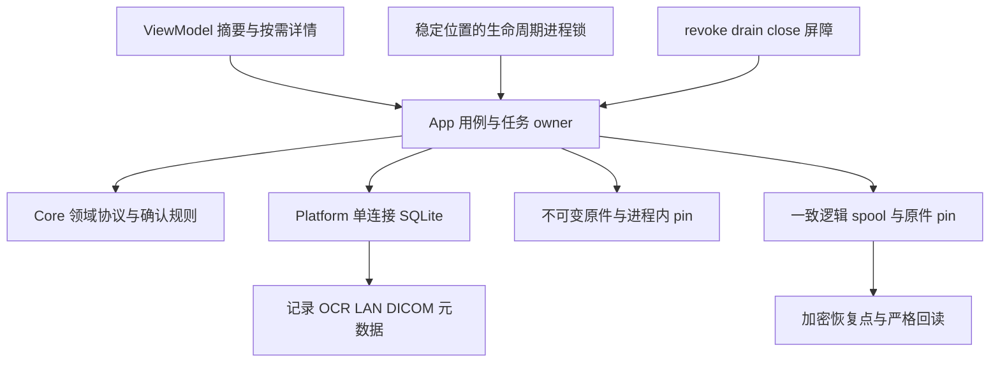
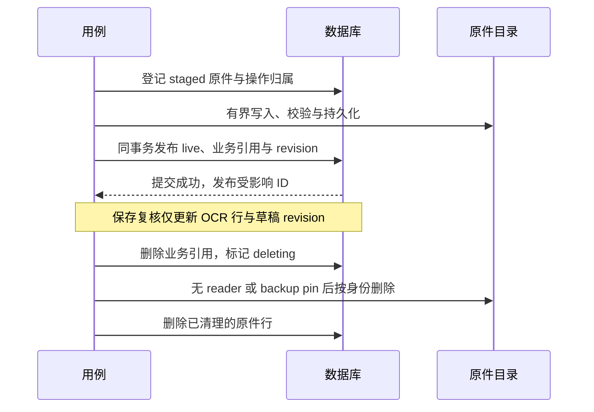
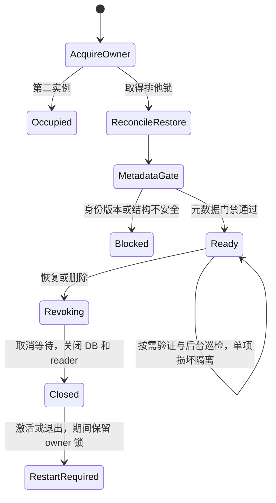
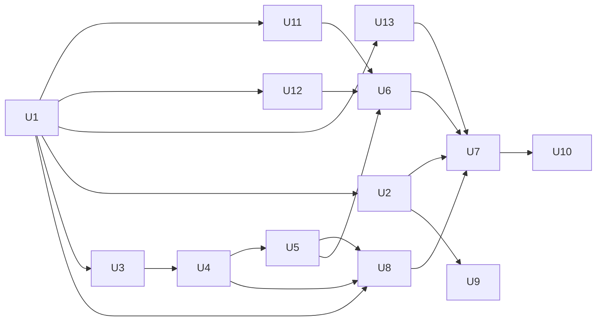

# SQLite 与应用架构分阶段重构计划

本文是待实施的决策与验收契约，不是执行进度或当前能力声明。当前事实见 [架构](../architecture.md)、[存储](../storage.md)、[备份与恢复](../backup-and-restore.md)；后续实施结果进入专题页和 [日志](../log.md)。

## Goal Capsule

在正式发布前解决已测得的近上限资料库刷新约 4.9 秒、保存约 13.4 秒、导入约 48.7 秒和操作进程峰值 4.4 GB 问题，并消除启动全量读原件、备份及去重的重复全库工作。先修独立缺陷，再以 SQLite、按需查询及明确的完整性模型完成重构，保持来源确认、LAN 会话、DICOM XPC 和备份信任边界。

**路线：保留 Swift / Core–Platform–App 分层；SQLite 保存全部业务元数据、OCR / 复核文档及规范化 DICOM 索引，只有原件继续作为不可变文件。** 新存储、按需 App 查询、LAN、DICOM、逻辑备份 / 恢复全部适配后一次切换生产组装。不引入 JSON / SQLite 混合生产库。

实施基线为已核对远端的 **`origin/main@09f57b1`、Swift tools 6.2、macOS 26.0、DICOM-Swift 1.5.0**。macOS 26 升级已随 PR #13 合入；27 是单列兼容性矩阵。编辑本计划的本地 `main@4f0f2d8` 落后一个 PR，本轮不覆盖已有工作树改动。实施从最新主线开始；AgentRunKit / 授权 / BYOK 仍是独立功能范围。

本版替代本文初稿中的 macOS 14 基线、无实测、OCR / DICOM 索引留文件、多进程交替写、物理 DB 备份和切换后才做查询等方案。另一工作树的计划仍是提议，不能把转达当成用户已批准；具体对照及测量出处见 [修订证据](../sources/2026-10-11-storage-plan-revision-evidence.md)。

## Product Contract

### Requirements

| ID | 必须满足的结果 |
| --- | --- |
| R1 | 完整覆盖成员、报告、草稿、附件、LAN durable inbox、DICOM 元数据的持久化、删除、去重及重启恢复；不丢失既有来源关系和用户修订。 |
| R2 | 只有用户确认的来源转录进入时间线、搜索和比较；OCR 候选仍可失败、重试和复核，不产生新的医学结论。 |
| R3 | 启动先完成数据库身份、版本和结构门禁，不全量哈希原件；按读取和后台巡检发现的单项损坏隔离到该项，已有良好记录仍可用。 |
| R4 | 长任务由应用级服务管理，切换页面不重复启动任务；整库恢复或删除能够撤销并等待全部任务，拒绝迟到结果。 |
| R5 | 每个资料库只允许一个 App owner；SQLite 与外部文件满足崩溃恢复、排他接管和非破坏性格式拒绝，失败不能静默清空、覆盖或降级打开。 |
| R6 | 新布局支持与 schema 解耦的加密逻辑备份、严格恢复和原件 ZIP；备份容量覆盖资料库与 durable inbox 的实际可表示内容，不再以 2 GiB / 20,000 条目误拒合法的大库。 |
| R7 | 查询、UI 刷新和自动备份按持久变更收敛；无关报告修改不关闭未变化的 DICOM Viewer，相关对象变化仍立即失效。 |
| R8 | OCR / 原件读取与并发任务保持可测量的资源上限；不因新依赖、日志或临时文件扩大健康资料暴露面。 |
| R9 | 每阶段有代码范围、真实链路测试和明确退出门禁；性能收益只能由同条件合成基准证明，不能用重构后的结构推断。 |
| R10 | 在 SQLite 切换前独立修复备份复核平方增长、备份容量不匹配和导入去重平方增长，保留现有校验与去重结果。 |

### Key Decisions

- **KD1（用户已明确）**：应用尚未发布，可以调整架构；将 SQLite 与其他优化编为分阶段完整计划。Governs R1、R3–R9。此决定不授权删除开发资料、不等于第三方库或迁移方案已实测通过。
- **KD2（现行产品契约）**：单机单用户、活动库明文、无 Keychain / 账号 / 内置云同步 / 遥测；LAN 是用户显式开启的私人网络普通 HTTP；DICOM 是受限辅助能力。Governs R2、R4–R8。外部备份沿用现有认证加密，不把数据库替换描述为活动库加密。

### Scope Boundaries

本次不改产品定位、页面信息架构、LAN HTTP 协议、备份加密算法 / 信任链或 DICOM 解码框架。备份格式的容量与 payload 版本需要变更，不能写成整个备份协议不变。复用 actor、lifecycle、来源模型及路径校验，不建立通用插件框架、作业平台、CQRS 或永久双后端。

**Deferred to Follow-Up Work**：FTS5 / 中文分词、并行数据库读池 / WAL、自带 SQLite engine、旧开发库离线转换器、自动修复损坏库。OCR 共享处理 U9 是可独立交付的 P2 支线，不是切换前置；OCR / 复核持久化入库和资源上限则必须在主线完成。原件 ZIP 不包含完整元数据，不能替代迁移或完整恢复。

### Assumptions

1. 默认采用开发期 **current-only 新格式**：不实现旧 JSON v3 和旧备份到新格式的自动转换；发现旧布局时停止打开并保留原样。新版只在确认为空、由 App 拥有的目录初始化。切换前若仍需在新版继续使用旧开发资料，必须先完成单独的离线转换方案，不能以“未发布”为由删除资料。
2. 仅验证 macOS 26 / 27 的系统 SQLite；不再承担 macOS 14 / 15 验收。已有 JSON 规模测量是输入；本计划的新实现目标尚待验证，不能把 7 次中位数标成 p95，也不能把 24 小时外推写成完成实测。

## Planning Contract

### Evidence and Current Constraints

[规模测量来源与统计口径](../sources/2026-10-11-storage-plan-revision-evidence.md) 已核对探针和代码；本轮没有复跑。近上限档为 9,990 份报告、9,791 条已确认记录、19,980 个对象，M1 Max / 64 GB / 内置 APFS / Release / 热缓存。

| 痛点 | 已有证据 | 本次必须解决 |
| --- | --- | --- |
| 全量目录反复物化 | 刷新 4,859 ms，保存复核 13,414 ms，footprint 4.40 GB（7 次中位数 / 进程峰值） | 窄事务、冷数据独立表、摘要与详情分离；验收绝对延迟和内存 |
| 搜索阻塞主 actor | 无命中 / 稀有词 / 日期分别 328 / 469 / 528 ms，中位数 | 查询移出主 actor，保持语义，近上限查询目标 p95 ≤ 100 ms |
| 启动读取全部内容 | 报告档 14.17–18.97 s；同结构照片档 41.5–44.5 s | 启动只做元数据门禁，原件与大文档按需验证；明确损坏发现时机变化 |
| 备份复核 O(条目数 × 目录大小) | 500 份报告完整发布 243 s；近上限估算 87,528 s，未实际完成 | U11 在 JSON 上先修；新快照不把全源复核放进每条目打开 |
| 备份容量不足 | 合法 9.76 GiB 照片库被 2 GiB 上限拒绝；另有 20,000 条目、30,000 frames 限制 | U12 联动 writer / reader / trust / restore 的所有容量边界 |
| 导入去重 O(记录数 × 附件数) | 导入一个新原件 48,707 ms；每个候选重建附件字典 | U13 先共用查找表，再由索引匹配指纹 |
| 队列耦合目录 | 大库下发布 32 KiB 文件约 20 s，队列刷新约 2.2 s | 单库事务与常数成本身份校验；不搭混合后端 |
| DICOM / OCR 大对象 | 全库解析重读全部 study index；ImportDraftDocument 保存用户 reviewState | DICOM 规范化表；OCR / 复核独立表，保存复核不再发布新对象文件 |

[2026-09-08 审查](../architecture-review-2026-09-08.md)要求的规模测量现已存在。数据支持推进重构，不再以“尚无性能压力证据”解释 SQLite。测量不覆盖真实 UI、冷缓存、DICOM 解码和恢复耗时，这些新增门禁仍需实际完成。

当前编辑树的专题仍描述旧实现和旧系统；执行 U1 对齐 `09f57b1` 后再编译专题事实，不能把旧检出文档误判为最新主线。旧 `decisions.md` 的私有仓库 / 备份未来表述仍须结合最新代码核实，历史来源笔记不改写。

### Key Technical Decisions

- **KTD1 — 全部业务元数据入库**：成员、报告、草稿、来源、OCR / reviewState、LAN durable 状态和 DICOM study / series / instance 图进入一个数据库。只有原件字节、在途 partial 和操作 staging 留文件。OCR 大 payload 独立表，热查询不取它；DICOM 不再保留整份 index 文件或整个 study BLOB。数据库版本、逻辑快照版本与库 identity 分开管理。
- **KTD2 — 绑定与连接**：采用精确锁定候选 GRDB `7.11.1` + 系统 SQLite，仅 Platform 依赖；先完成 tag / 公告 / 隐私资源核查。一个串行 DatabaseQueue，不引入读池或 WAL；目标配置为 `journal_mode=DELETE`、`synchronous=EXTRA`、`fullfsync=ON`、`foreign_keys=ON`、`trusted_schema=OFF`、defensive、禁用 extension loading。设置后查询 / 探针核实生效，不能把未知 PRAGMA 静默忽略当成功。macOS 26 和 27 的 Apple engine 分别取证；依赖版本不代表 engine 版本。选择 GRDB 是减少自写 C 绑定、事务与迁移代码，不为使用其 ORM / 观察机制扩大模型。
- **KTD3 — 单 owner 与文件生命周期**：资料库整个打开生命周期持有排他进程锁，第二个 App / fixture 在打开 DB 前返回占用状态，不支持两个进程交替写。锁位于被替换根之外的稳定 App-private 协调位置，并绑定可信 runtime identity 和根身份，恢复不能换掉锁 inode。复用 VaultProcessLock 的内核锁与别名防护；进程内保留 admission / pin / mutation 串行。DICOM XPC 不打开库。备份 repository 的跨设备 / 跨进程发布 lease 和 witness 独立保留。
- **KTD4 — 事务与接口**：用例提交局部命令，列表返回摘要，详情 / 编辑 / 比较按 ID 读取；并发任务用实体 revision / attempt ID 拒绝迟到结果。原件通过 `staged → live → deleting` 和归属操作 ID 收敛：登记后写入并同步，业务事务发布引用，解除引用后按身份回收；reader / snapshot pin 防止提前删除。保存 OCR 复核只改数据库行，不写对象文件。Core 的 ID、确认门、去重优先级和来源语义保持，不能借统一表合并原本不同的 draft / record ID。
- **KTD5 — 任务与通知**：应用级 owner 管理导入恢复及 LAN 预处理；沿用已有状态而非通用 job 表。成功提交发布库 epoch、revision 和受影响 ID，订阅安装后对账，内存事件遗漏靠持久 revision 补偿。删除多 writer 观测需求；备份重启补偿、LAN byte progress / liveness 和同进程后台变更仍必须保留。
- **KTD6 — 逻辑备份**：恢复点保存版本化、确定顺序的领域记录流和不可变原件，不包含 SQLite 数据库文件。元数据捕获在一致读事务与短时 mutation admission 内完成，并同时固定原件 pin；先流式生成私有、封口的元数据 spool，再释放 admission，从 spool 与 pinned originals 创建恢复点。捕获阶段的可取消等待单列限时，不把整段原件复制放在锁内。恢复用受限逻辑 reader + Core 校验创建全新数据库，只执行随 App 发布的 schema，不打开恢复点携带的 DB / SQL。U6 建立版本化 reader 及固定 v1 fixture；未来保留已发布逻辑版本 → 当前领域模型的映射。数据库迁移仅处理自己的已知 schema。
- **KTD7 — 查询与失效**：保持既有 confirmed-only、子串、中文短词、大小写 / 本地化、日期及稳定 ID 次序；默认 LIKE / lower 不视为等价。按列查询或经等价测试的有界匹配，搜索离开主 actor。Viewer token 使用库 epoch + study content revision + 目标原件身份，拒绝相关损坏或替换；无关报告修改不撤销。App 按需路径在 U7 切换之前完成。
- **KTD8 — 任务与资源支线**：共享 OCR 处理是独立 U9，不强迫与 SQLite 串行。主线 U3–U6 已负责有界读取、行 / 单文档限制、取消与内存硬门槛；U9 在此基础上复用来源归属和候选处理，避免机械替换所有 Data 或新增通用 pipeline。
- **KTD9 — 分层完整性**：采用下表的启动、读时、巡检、备份 / 恢复模型；不再以启动全量 SHA-256 作为 Ready 前提，也不宣称 quick_check 等价于整份目录摘要。

SQLite 的 PRAGMA / 防御配置依据见 [修订来源](../sources/2026-10-11-storage-plan-revision-evidence.md)，原 GRDB / WAL / 备份 API 事实仍保留在 [初版来源](../sources/2026-10-10-sqlite-architecture-references.md)。单实例下 WAL 并非必要；不能用“最低系统已升到 26”代替实际 engine 核实。

### Integrity Model

| 时机 | 强制验证与行为 | 明确不作的保证 |
| --- | --- | --- |
| 打开前 | 取得稳定位置 owner 锁；可信目录、普通文件 / nofollow / 属主权限、恢复 receipt、已知布局；只读预检 `application_id` / `user_version`，未知格式在任何迁移或持久 PRAGMA 写入之前拒绝 | 不把 DB 缺失当空库；不对未知库做“修复”或 journal 切换 |
| Ready 前 | 支持版本的自有库按受控流程恢复 journal；`quick_check`、`foreign_key_check`、库身份与关键状态 / 上限校验；失败进入既有降级恢复入口 | 不读取全部原件，不解码全部 OCR，不展开全部 DICOM 图；quick_check 会扫描 DB 页，本身不是 O(1)，必须测量 |
| 读行 / 文档 / 影像图 | 校验对应行的规范内容 SHA-256、版本、Core 构造和来源闭合；列表只校验摘要行，详情读取其冷 payload；DICOM 按目标 series / instance 读取 | 行哈希检测意外改字节，不认证数据，也不完全检测一组自洽行被删除；不承诺启动时发现所有语义损坏 |
| 读原件 / 解码 / 导出 | 用 opaque ID 打开绑定的普通文件，流式校验长度与 SHA-256，校验前不交给 PDF / Vision / XPC；保持描述符身份与最终发布围栏 | 不依赖“以前验证过”跳过被替换字节；缓存验证只可绑定精确文件身份与生命周期 |
| Ready 后巡检 | 应用空闲时有界、可取消地执行完整行 / 领域图及原件校验；调度 `integrity_check` 与 FK 检查，不阻塞 Ready。记录巡检时间 / 进度，不记录内容 | 未巡检即标为未巡检；不是对恢复完整校验的替代 |
| 发现损坏 | 结构 / schema / FK 或全局 identity 不安全则整库 fail closed；单个原件、OCR、记录或 study 内容损坏只禁用相关读取 / 修改 / 确认，显示可恢复错误，保留字节，其余良好项继续可用 | 不自动重建用户修订或静默删坏项；已知损坏不能绕过备份 / 导出校验 |
| 备份 / 恢复 | 备份验证所有被捕获逻辑行、关系与原件，并完整回读容器；恢复 staging 和 activation 后都严格检查 DB 结构、FK、全部逻辑哈希与原件摘要 | 任何缺件 / 不一致都不得标为成功；恢复仍不清理 / 修复候选来凑通过 |

**整份目录 SHA-256 的替代**：每张持久业务表的语义行或独立 payload 有规范编码的内容摘要，覆盖主键、版本、引用与用户内容；写入投影与 payload 在同一事务更新，读取所需行时校验。备份记录流另外带版本、每类计数和整体逻辑摘要，恢复核对缺行 / 多行。没有对活动数据库逐提交哈希全文件、没有 Merkle 树；检测时机从“启动验证全部”变为“结构门禁 + 使用前验证 + 后台巡检”。这是有意的行为改变，U3 / U7 必须同步存储、隐私说明和降级 UI 测试。

### Schema Draft

这是一版可评审的关系草案；U3 提交最终 DDL 和 fixture。使用 STRICT 表、UUID 固定 16 字节、摘要 32 字节、整数时间与非负 revision / byte count；所需特性在 macOS 26 engine 上验证。所有业务行有 `content_hash`（表中省略重复列），派生查询投影不得成为无校验的第二份事实。

| 表 | 主键与主要字段 | 关系 / 约束与索引 |
| --- | --- | --- |
| `library_state` | singleton；library_id、generation、commit_id、schema_identity | 单行；generation 仅作持久变更序号，不替代实体 revision；运行 epoch 不从旧备份复用 |
| `members` | id；display_name、disambiguation、archived、revision | 唯一 ID；报告和 study 外键引用 |
| `originals` | id；byte_count、sha256、content_type、lifecycle、operation_id | staged / live / deleting；digest + length 查询索引；文件名只由 ID 生成，不以 SHA 作认证 |
| `reports` | record_id；member_id、revision、timeline_date、date_kind、摘要 / 可搜索已确认字段、fingerprint | 只放已确认记录；`(member_id,timeline_date,record_id)` 及全成员日期索引；指纹索引非唯一，保持原去重结果优先级 |
| `report_details` | record_id；规范来源字段 / 日期候选 / 异常 / 备注 payload | PK 同时 FK → reports；冷热分离，同事务更新摘要与详情 |
| `import_drafts` | draft_id；state、revision、attempt_id、failure_code、document_id、fingerprint | FK → ocr_documents；有效状态沿用领域枚举，needsReview 指纹索引；确认事务创建指定 record_id 并删除草稿，二者 ID 不擅自合并 |
| `report_sources` | 内部 row_id；source_id、report_id 或 draft_id、position、original_id、page_count、展示名 | 两个 owner 外键恰一非空；各 owner 内 source_id / position 分别唯一，不能将 source_id 强化为全库唯一；original_id FK → originals；确认时转移 owner，保留 source_id |
| `ocr_documents` | id；document_version、extraction_version、revision、payload、sha256 | payload 保存 ImportDraftDocument（blocks / candidates / reviewState），保留单文档 16 MiB 门禁；reports 增加 document_id FK；保存复核与 draft revision 同一事务，无外部 OCR 文件 |
| `inbox_items` | id；sequence、revision、state、original_id、derived_document_id、failure_code | FK → originals / ocr_documents；sequence 唯一，状态 / sequence 索引；不会存配对码、cookie 或 CSRF |
| `inbox_transport_receipts` | `(session_id,remote_file_id)`；outcome、item_id / terminal ID | 幂等回执；归档 / 取消 / 重试必须保持现有会话 fence |
| `inbox_content_terminals` | `(session_id,sha256,byte_count)`；kind、revision | 消费 / 取消 tombstone 与记录提交原子更新，不恢复接收会话 |
| `dicom_studies` | id；state、member_id、effective_date、fingerprint、study_uid_digest、content_revision、index_version、ordering_policy | confirmed 门；保留 UID domain / scope 规则和 policy v2；按成员 / 日期索引 |
| `dicom_objects` | `(study_id,original_id)`；retained_kind | FK → studies / originals；包含 viewableImage 与 inertAttachment，惰性附件不进入 instance 表 |
| `dicom_series` | `(study_id,series_id)`；series_uid_digest、ordinal、ordering_provenance、revision | FK → studies；同 study 内 series digest / ordinal 分别唯一；序列摘要可按 study 读取 |
| `dicom_instances` | `(study_id,series_id,instance_id)`；original_id、sop_uid_digest、ordinal、尺寸 / 位深 / 几何 / 窗位等已允许属性 | 复合 FK → series、`(study_id,original_id)` → dicom_objects；study 内 instance_id / original_id / sop_uid_digest 分别唯一，series 内 ordinal 唯一；按 series + ordinal 索引，单切片不物化其他 study |

DICOM 不保存原始 UID、患者姓名或完整任意 tag；几何与像素属性沿用 [DICOMStudyIndex](../../Sources/KinlogueCore/Domain/DICOMStudyIndex.swift) 的允许字段及 Core 校验。原 16 MiB index 编码限额对应每 study 的等价逻辑编码预算，series / object 上限保留；不能因拆表便放宽规模。series 与 instance 插入、study 发布、原件 live 和去重指纹在同一事务完成。

LAN 归档将 inbox 所拥有原件 / OCR 关系转成草稿关系，并在同一事务记录 terminal；无需复制相同原件。来源 ID 重新归属时必须通过现有 provenance 校验。没有当前用途的 settings 表、通用 job 表与永久事件表不建。

### Backup Choice and Capacity

| 方案 | 收益 | 成本 / 本版结论 |
| --- | --- | --- |
| SQLite online backup 产生物理 DB 恢复点 | 实现较小，直接获得一致数据库镜像 | 恢复点绑定 schema；未来须保留旧 schema 迁移；要打开外来 DB。可以防御，但本版不选 |
| 版本化逻辑记录流 + 原件 | 恢复建立自己的 DB，DB schema 可独立演进；可核对确定性计数 / 摘要 | 需要 bounded writer / reader / 兼容 reader 和完整矩阵；**本版选用**，计入 U6 工时 |

逻辑版本不等于“永远不用迁移”：已公开发布的快照版本 reader 必须继续把旧逻辑映射到当前模型；开发期旧 JSON 恢复点继续 current-only 拒绝。本版不把 DB 文件塞进容器，也不把“不打开外来 DB”描述成逻辑 parser 无风险。

元数据 spool 捕获完成后，前台可以继续写；已 pin 的原件不能被 GC 删除。该恢复点覆盖的是捕获 revision，不一定是发布瞬间最新 revision；调度器不能把后来的修改标成已备份。容器发布继续使用现有授权、签名、witness 和 high-water fence。文件逐项检查只需 owner / epoch / 身份与该文件摘要，不重读整份源库。

**容量修复 U12 必须先于切换独立交付**：去掉与资料库准入不一致的 2 GiB / 20,000 entries / 30,000 frames 固定低上限；按 Vault、durable inbox、派生文档及 manifest 真实清单，以 checked arithmetic 计算 entry count、字节、`Σceil(entryBytes / 256 KiB)`、manifest 长度和磁盘余量。保留字段宽度、每帧上限、每项解码上限、nonce 不复用与加密安全预算，禁止信任 header 就分配巨量内存。旧格式的 writer / reader 约束不能静默改变，必须有新容量格式版本及旧 reader 明确拒绝测试。

LAN 当前没有总字节 quota，因此不能由 20,000 个 Vault 对象推导整库总字节上限。U12 必须给出实际支持的编码 / 加密上限和前置容量判断：若现有 UInt32 frame 编码或安全预算覆盖不了合法输入，先扩展受版本保护的表示或明确阻塞，不借降低 LAN 准入、省略 inbox、分出不完整恢复点来通过。最低实证覆盖 9.76 GiB 照片档，以及 20,000 Vault 对象加 manifests、durable inbox / derived 超过 20,000 entries 的组合。大容量有界流式读取、溢出拒绝、可取消、空间不足原库不变与真实恢复缺一不可。15 分钟当前探针预算与协议可表示上限分开，不能沿用固定时间阈值误拒更大但持续前进的合法备份。

### High-Level Technical Design

图与表约束职责、关系和顺序；最终 DDL、Swift 类型和错误映射在对应单元提交评审，不扩展产品能力。







打开顺序是“锁 → 恢复 receipt → 根布局 / 格式识别 → 已知库恢复与检查 → Ready”。空根才初始化；旧 JSON、未知 DB header / schema 或未知非空目录原样拒绝。后台处理和巡检不越过 Ready 前门禁；恢复时仍执行完整验证。

### Phases, Dependencies and Effort

P0 是数据与切换门禁，P1 是主要交互收益，P2 是独立整理。单元 ID 保留初稿编号，新增 U11–U13 不重编号旧项。下面是依赖图，不是把所有工作排成严格串行。

| 阶段 | 单元 / 优先级 | 可交付范围与退出标准 | 专注人日粗估 |
| --- | --- | --- | ---: |
| S0 对齐证据 | U1 / P0 | 基于 09f57b1，复用已有 probe、固定统计口径和新阈值，不新增大规模主测试 | 0.5–1 |
| S1 前置修复 | U11、U12、U13 / P0 | JSON 上先消除备份 / 去重平方增长，大库备份与恢复通过 | 4.5–8 |
| S2 并行准备 | U2 / P1；U3 / P0 | 任务 owner 可独立交付；SQLite 单实例、完整性及全域 schema 在隔离根通过 | 7–12 |
| S3 全域持久化 | U4、U5 / P0 | 报告 / OCR、LAN、DICOM 的所有事务闭环；不改生产后端 | 9–15 |
| S4 切换前适配 | U8 / P1；U6 / P0 | 按需 App、通知、Viewer 与逻辑备份 / 恢复 / 导出均完成 | 10–16 |
| S5 一次切换 | U7 / P0 | 正式组装一次替换全部角色，安装链路与绝对性能门槛通过 | 1–2 |
| S6 核心收尾 | U10 / P0 | 清旧路径、文档 / 全量测试 / 故障矩阵与安装验收 | 3–5 |
| 独立支线 | U9 / P2 | OCR 共享处理与进一步热点整理，可在 U2 后另行交付 | 3–5 |

**估计口径**：核心 U1–U8、U10–U13 共 35–59 人日，约 7–12 个工作周；含 U9 为 38–64 人日，约 8–13 周。一位熟悉仓库的开发者连续投入，含代码、定向测试、故障注入与文档，不含真实设备借用、人工等待、旧资料转换或发布签名。估计未经历史校准；新容量格式、逻辑恢复和损坏隔离是主要不确定项，排期另留约 20% 余量。并行是减少依赖等待，不代表人日直接减半。



U2 与 U3 **无相互依赖**。U8 可先在 JSON 适配器上收窄 App 契约，最终按需 SQL / DICOM 查询验收依赖 U4、U5。U6 和 U8 可并行；U7 必须等待两者。U9 不阻塞 U7 / U10，执行时与 U4 的 OCR 协议修改错开即可。U11 / U13 是小修，U12 是独立中等改动，不能为赶“小修阶段”跳过格式与大容量验证。

## Implementation Units

先查齐调用方与现有测试，再强化能证明行为的最小覆盖。性能 probe 不进入主 XCTest inventory；正确性回归测试仍按真实改动更新账本。以下路径以实施基线为准，新增文件明确标注；所有实现仍是未来工作。

### U1. 对齐主线并接续现有测量（0.5–1 人日）

- **Requirements / Dependencies**：R1–R10；无。
- **Scope**：从 `origin/main@09f57b1` 起步；接续已有 `scripts/run-storage-scale-probe.sh`、`Sources/KinlogueStorageProcessFixture/StorageScaleProbe.swift` 及 fixture 的命令分发改动。它们尚在测量工作树未提交，按来源哈希核对并纳入实施变更，不重新发明 `LibraryArchitectureBaselineTests`。
- **Approach**：保留原档位 / 种子 / 指标，补新 store 适配和操作选择、采样参数所需的最小改动；核对 macOS 26 / 27 与 DICOM 1.5.0。原始 baseline 直接采用已测结果，只在可比性有变化时重测相关档位，不默认重跑两小时 `--all`。
- **Scenarios / Exit**：确认探针只能访问其自建合成根，超时 / 取消 / 空间不足不会误清理其他目录；主测试清单没有新增规模档。冻结本文延迟 / 内存 / 备份门槛、测量口径和来源版本。脚本 / fixture 定向安全测试适用，纯文档部分不新增行为测试。

### U11. 先修备份全源复核平方增长（1–2 人日）

- **Requirements / Dependencies**：R5、R6、R9、R10；U1。
- **Scope**：`PlaintextLibraryBackupSource.swift`、`VaultRootBinding.swift` 及 Vault / inbox snapshot 验证调用者，必要时覆盖 LAN 相同根身份热路径；不改存储格式。
- **Approach**：准备时完整解析验证并固定源 token；每条目检查已绑定的根 / manifest 文件身份和相应文件，避免逐项重新解码 catalog；最终发布在 lease 内再次做完整源一致性验证。缓存只有精确身份匹配才可复用，不能只比路径或 generation。SQLite 上线前仍保留当前多进程 mutation 协调，不能提前删掉其保护。
- **Scenarios**：备份中任一源修改、同路径替换、文件损坏、lease 竞争立即拒绝错误快照；正常备份 catalog 解码次数对条目数为常数。手机队列受益可记录，但不以减少安全检查换速度。
- **Tests / Exit**：`PlaintextLibraryBackupSourceTests.swift`、`VaultRootBindingTests.swift`、`BackupPublicationProcessCoordinationTests.swift` 与现成 probe；reports-1000 完整发布 ≤ 10 s，reports-20000 ≤ 120 s；完整回读、witness 和恢复验证不能省。旧 24 小时外推不是需要等候完成的基线。

### U12. 先修备份格式容量不匹配（3–5 人日）

- **Requirements / Dependencies**：R6、R8、R10；U1，完整大容量耗时验收使用 U11。
- **Scope**：Core `BackupCheckpoint.swift`、`BackupManifest.swift`、`BackupTrustRecords.swift`；Platform `EncryptedBackupContainer.swift`、`BackupContainerReader.swift`、`BackupTrustVerifier.swift`、`BackupRepository.swift`、`EncryptedCheckpointRestore.swift`、source；容量 UI、probe 与相关 fixtures。
- **Approach**：落实 Capacity 节的 entries / plaintext / frames / manifest / ciphertext / 空间余量联动表，逐一检查整数转换与加密计数器。为 JSON payload 的扩容分配新格式版本和 minimum-reader 约束；旧 reader 明确拒绝，新 reader 不按旧低上限误拒新数据。U6 的逻辑 payload 再独立版本化；开发期可以两次升级，不在同一版本偷偷改变上限。原 v1 reader 是否保留只影响开发恢复点兼容，按 current-only 明示，禁止自动丢弃旧恢复点来使 repository 可用。
- **Scenarios**：9.76 GiB 照片库完整备份 / 干净恢复；20,000 Vault 对象再加双 manifest、inbox 和 derived 后超过旧 entry 上限仍闭环。伪造长度、整数溢出、超过实际格式 / 加密预算、磁盘不足、nonce 边界、取消均安全拒绝且保留原库；writer 与 reader 预算一致。
- **Tests / Exit**：`BackupCheckpointManifestTests.swift`、`EncryptedBackupContainerTests.swift`、`EncryptedCheckpointRestoreTests.swift`、trust / repository 相关测试；流式完整回读 / 恢复和本文容量门槛通过。不得仅更改 2 GiB 常量或用“计划完整支持备份”代替这个门禁。

### U13. 先修精确去重平方增长（0.5–1 人日）

- **Requirements / Dependencies**：R1、R9、R10；U1。
- **Scope**：Core `DuplicateDetector.swift`、`ReportFingerprint.swift` 及导入 / LAN 归档调用方。
- **Approach**：每次检测只验证并建立一次附件字典，复用于每个候选指纹；保留 fingerprint 对多来源及重复来源的语义、已确认记录优先于 needsReview 草稿、稳定 ID 选择规则。不为此引入永久缓存层。
- **Scenarios / Tests**：在 `ImportDraftTests.swift` 与 `ReportSourceAndFingerprintTests.swift` 覆盖乱序 / 重复来源、损坏引用、多个重复候选与优先级；复用导入及 LAN 真实 service 集成。访问计数证明全量附件字典只建一次，来源排序与稳定 ID 选择的既有成本单列，消除 O(记录数 × 附件数) 的重复工作，近上限 detector ≤ 100 ms；同口径整体 stage 先降至 ≤ 20 s，SQLite 目标另见性能表。

### U2. 收拢任务所有权与启动恢复（2–4 人日）

- **Requirements / Dependencies**：R3、R4、R8；U1，**不依赖 U3**。
- **Scope**：App `AppServices`、`AppComposition`、`AppStartupCoordinator`、`LibraryLifecycleCoordinator`、`LANInboxModel`；提取最小应用级处理 owner。
- **Approach**：在当时后端的安全门禁通过后 ready，恢复 OCR 在后台；JSON 阶段暂保留原启动校验，新的读时验证到 U3 / U7 生效。LAN ViewModel 不拥有队列；复用 draft / inbox 状态和取消登记，失败不忙循环。U8 前通过已有 composition callback 自动回显成功 / 失败，U8 后统一事件。
- **Scenarios**：阻塞 OCR 时已有良好记录可用；释放后自动出现复核 / 重试入口；页面切换不丢任务或重复启动；恢复能 cancel / drain，迟到结果不回写。
- **Tests / Exit**：`LiveAppServiceTests.swift`、`LANInboxModelTests.swift`、`BackupCompositionTests.swift`、`BackupConcurrencyRegressionTests.swift`；补真实 service + AppModel 链路，不只改 mock。此单元可独立在旧存储交付。

### U3. SQLite 内核、单实例与完整性（5–8 人日）

- **Requirements / Dependencies**：R3–R5、R8、R9；U1，**不依赖 U2**。
- **Scope**：新增 Platform `SQLiteLibraryStore.swift`、schema / migration 最小实现；`VaultProcessLock`、根身份与文件协调；`Package.swift` / lockfile / 第三方声明 / package graph / App bundle 脚本及测试。
- **Approach**：实现 KTD1–KTD4、KTD9 和完整 schema 草案，DICOM 表从第一版进入；验证配置与完整性层次。owner 锁贯穿打开、revoke、DB close、根 activation / rollback 直到退出，进程内 admission 保护 staged / live / deleting 与 pin；busy 仅作为异常有界失败，不是多 writer 重试协议。未知 schema 先只读识别，禁止 erase-on-schema-change。
- **Scenarios**：第二个进程在 DB 打开前被拒；owner SIGKILL 后新进程能接管；大小写别名、根替换、恢复期间第二实例、同进程重入和释放顺序正确。文件登记 / 写入 / commit / GC 每点强退，只得到旧状态或完整新状态。元数据坏库 fail closed；坏单项按 Integrity Model 隔离；Ready 不读原件字节。
- **Tests / Exit**：新增 `SQLiteLibraryStoreTests.swift`、`SQLiteStorageProcessTests.swift`，保留真实独立进程 fixture；把新后端“双进程轮流写成功”测试改成“拒绝第二 owner”，不删 crash / 根替换测试。macOS 26 / 27 engine 配置、依赖图、隐私资源、许可证和安装包通过，DICOM Helper 不链接 DB 库。

### U4. 报告、OCR 复核与窄查询事务（5–8 人日）

- **Requirements / Dependencies**：R1、R2、R5、R7、R8；U3。
- **Scope**：Core `VaultProtocols`、现有 `ImportDraftStore` 协议 / 领域构造、Platform draft store、新 DB 命令 / 查询、App service；不再强制 ImportWorkflow 取全量 catalog。
- **Approach**：按 schema 保存记录、草稿、来源、OCR 文档与 reviewState；确认、编辑、删除为局部事务，索引去重仍复用原指纹语义。详情 / 比较按 ID，列表只返回摘要；冷 payload 不随全局 refresh 读取。OCR 保存无需对象目录 rename / orphan GC。
- **Scenarios**：复核更新 OCR、用户修订与 revision 全部成功或全部失败；强退后不混代；未确认内容不可搜索 / 比较；指纹匹配顺序保持；共享原件不误删。坏 OCR / 原件隔离到相关记录，不能把已有正确用户修订当缓存重建。
- **Tests / Exit**：`ImportDraftTests.swift`、`RecordQueryTests.swift`、`VaultCatalogDeletionTests.swift`、`LiveAppServiceRecognitionIntegrationTests.swift`；新增 `LibraryQueryIntegrationTests.swift`。访问计数证明单记录保存不解码全库、不写 OCR 外部对象、不读无关 DICOM。

### U5. LAN 与规范化 DICOM（4–7 人日）

- **Requirements / Dependencies**：R1、R2、R4、R5；U3，归档闭环依赖 U4。
- **Scope**：`PlaintextLANInboxStore`、`LANReportArchiveCoordinator`、DICOM import / index / session 调用者与 SQLite store；保留 HTTP、手机页面和 XPC 解码器。
- **Approach**：归档在同一事务转移 original / OCR 关系与来源，创建草稿和 terminal；不复制相同原件。按 study / series / instance 表发布索引，保留 ordering policy、UID digest 作用域、inert objects 和来源属性。只读取所选 study / series；取消 / attempt / session fence 保持。
- **Scenarios**：重复归档、取消、迟到上传只得到一份正确终态；源件损坏不被归档后静默删除；重启 / 恢复不重启 LAN。DICOM 无效几何、重复 UID digest、跨 study 引用、缺件、导入中断和读取目标损坏均安全失败。
- **Tests / Exit**：`LANReportArchiveTests.swift`、`LANReceiverFileLifecycleTests.swift`、`LANPhoneAssetSafetyTests.swift`、`DICOMImportWorkflowIntegrationTests.swift`、`DICOMSliceVaultIntegrationTests.swift`；真实 DB 上确认“无单独 index 文件”和按 series 有界读取；不因合表删除网络进度或回执覆盖。

### U8. 切换前完成 App 按需查询与通知（4–6 人日）

- **Requirements / Dependencies**：R2、R7–R9；可在 U1 后开始，完成验收依赖 U4、U5。
- **Scope**：`AppServiceContracts`、`AppServices`、`AppModel`、`AppComposition`、`TimelineView` / `AppShellView`、详情 / 编辑 / 比较调用者、`DICOMViewerRegistry`、平台 session token、`BackupScheduler`、LAN monitor、本地化。
- **Approach**：AppSnapshot 不再常驻全量 HealthRecord；先在旧适配器改契约，再接 SQL 摘要 / 分页与按 ID 详情。成功提交驱动 UI / 备份；不设计跨进程写入观测。保留事件遗漏对账、备份启动补偿、partial 进度与 liveness。Viewer 不受无关 generation 变化影响，目标变化在访问和 frame 发布前校验。
- **UI / Scenarios**：加载不误报空库；成功为空才显示空状态；失败可重试；分页失败保留已有行，键盘能加载更多。切成员 / 搜索词重置 cursor / 请求身份，迟到结果不回闪；坏单项能识别且其他行可用，复用现有恢复入口。语义状态随中英切换更新。
- **Tests / Exit**：`AppModelTests.swift`、`AppLocalizationTests.swift`、LAN change / observation tests、`BackupSchedulerTests.swift`、`DICOMAppModelTests.swift` 与真实 platform Viewer 测试。将无关目录修改关闭 Viewer 的旧预期反转；达到查询 / App 内存指标。**未完成 U8 不允许 U7 生产切换。**

### U6. 逻辑快照、严格恢复与原件导出（6–10 人日）

- **Requirements / Dependencies**：R4–R6、R8；U5、U11、U12，与 U8 可并行。
- **Scope**：Core backup manifest / revision / logical schema；Platform source / writer / reader / restore verifier / root transaction / exporter；App backup / scheduler / lifecycle 与生产 restore process fixture。
- **Approach**：落实 KTD6：版本化、按 ID 确定顺序、分段有界的逻辑流；captured revision + original pin 建立无空窗。所有 OCR、用户修改、来源、LAN derived、DICOM 关系纳入逻辑快照；排除 staged / deleting / partial 与认证会话，processing 状态按可恢复规则归一化。一致捕获的临界区有取消与限时；随后读 spool 不再保持 DB 读事务。恢复新建受信任 schema，逐条校验插入，核对计数 / 摘要，严格验证后沿现有 receipt activation / rollback 流程换根。
- **Scenarios**：捕获中并发写不能混代，捕获后写不使旧 snapshot 不完整，也不被误标成已备份；删除 / GC 等待 pin；取消 / crash 清理本次 staging 与 pin。错误码、畸形逻辑记录、关系缺失、重复条目、版本未知、空间不足都不改活动库。所有 production restore phase 强退及 activation 后损坏精确回滚；旧 owner 任务不能污染新 epoch。
- **Tests / Exit**：`PlaintextLibraryBackupSourceTests.swift`、`EncryptedBackupContainerTests.swift`、`EncryptedCheckpointRestoreTests.swift`、`PlaintextOriginalArchiveExporterTests.swift`、`BackupSchedulerTests.swift`、`BackupRestoreServiceTests.swift`；保留 `BackupCapabilityActivationProbeTests.swift` / `BackupPublicationProcessCoordinationTests.swift`。新库 → 逻辑恢复点 → 干净恢复 → 报告 / LAN / OCR 修改 / DICOM / 导出全闭环；用冻结的逻辑 v1 fixture 在数据库 schema 演进后恢复，证明两者解耦；未来引入新逻辑版本时追加所有已发布版本的映射 fixture，不能只用当前 writer 自写自读。

### U7. 一次切换全部生产角色（1–2 人日）

- **Requirements / Dependencies**：R1–R10；U2、U4、U5、U6、U8、U11–U13 全部通过。
- **Scope**：AppComposition、AppStartupCoordinator、AppRuntimeIdentity、LiveApp / LAN / Backup / Export services、SyntheticAcceptanceRunner 和错误 / 降级状态。
- **Approach**：空的受信任根初始化新格式；旧 JSON、未知版本、未收敛 receipt 明确非破坏拒绝。报告、inbox、DICOM、备份、导出与按需 UI 一起切换，避免 PlaintextLANInboxStore 直接读 library.json 的过渡适配。不添加生产混合后端开关。完整性行为与 owner 占用提示同步用户文档。
- **Scenarios / Exit**：新版拒旧库、旧版拒新库均不改字节；原件损坏只隔离目标、元数据结构损坏降级；第二实例拒绝打开；新库所有真实 App 路径和绝对性能门槛通过。真实旧开发资料仍有迁入需求时，先做另行授权的离线转换，不以旧 ZIP 代替完整数据保留。

### U10. 核心收尾与验收（3–5 人日）

- **Requirements / Dependencies**：R1–R10 的核心范围；U7，不依赖 U9。
- **Scope**：旧 manifest / 全量 commit / 双提交生产路径、测试 / fixture / scripts；README、PRIVACY、架构 / 存储 / OCR / LAN / DICOM / 备份 / 隐私 / 并发 / 索引 / 日志和验收账本。
- **Approach / Scenarios**：删除旧生产 JSON 与多 writer 适配，只保留格式拒绝；不删第二实例、crash、根替换或 backup repository 竞争的测试。完整正常路径、故障矩阵、格式拒绝、安装启动 / 退出 / 重启 / restore 全部复核；相应当前能力文档只描述已经落地的行为。
- **Exit**：执行 Verification Contract；来源与报告注明 macOS 26 基线 / 27 兼容性、本机自动化、安装合成验收及真实设备 / 人工缺口。核心交付后可单独继续 U9，不把它伪报为完成。

### U9. 独立 OCR 共享处理支线（3–5 人日）

- **Requirements / Dependencies**：R2、R4、R8 的进一步简化；U2，**与 SQLite 无直接依赖**。
- **Scope**：TextExtractionService、ImportedFileValidator、OnDeviceTextExtractionService、LANItemPreprocessor、App report 识别 / 候选组装、本地化语义状态。
- **Approach**：只提取本地与 LAN 已有消费者共享的校验、抽取、来源归属与候选步骤，各自保留提交规则；大 Data 热点按测量调整为 Platform-owned lease，主线已有资源门槛不能等本单元才保障。
- **Scenarios / Exit**：同一合成输入的本地 / LAN 文本、来源和修订一致；损坏、超限、取消、重试不发布部分结果；混合 OCR / LAN / 备份保持资源预算。复用 `LiveAppServiceRecognitionIntegrationTests.swift`、LAN preprocessor、ImportDraft 与本地化测试；记录减少的重复逻辑与实测变化，不自建通用 pipeline。

## Verification Contract

### 行为与故障矩阵

| 场景 | 必须观察的结果 | 主负责单元 |
| --- | --- | --- |
| 保存复核 / 确认 / LAN 归档崩溃、返回丢失、重试 | 旧状态或完整新状态；同操作不重复；OCR 与用户修订同事务，良好源件不被提前删 | U3–U5 |
| 第二实例、owner 强退、根别名 / restore 替换 | 第二实例在 DB 打开前拒绝；强退后锁可接管；换根全过程排他，旧任务 / reader / 事件不能跨 epoch | U3、U7、U8 |
| 未知 application_id / user_version、热 journal、结构 / FK 损坏 | 未知库无写入拒绝；已知库按受控流程恢复；全局不安全不得 Ready | U3、U7 |
| 单行 / OCR / 原件 / DICOM 损坏 | 使用前发现并隔离目标，保留字节与用户修订；其他良好项仍可用；完整巡检 / 备份不得漏报 | U3–U6、U8 |
| 启动时原件增加 9 GiB、后台巡检取消 | Ready 前原件读取量为零；巡检有界、可取消，不抢占交互；未巡检状态不冒充完整验证 | U3、U7 |
| 备份中修改 / 删除 + GC | 捕获 revision、逻辑 spool 与 pin 集一致；后续修改不被标成已备份；完成 / 取消后释放 pin | U6 |
| 旧已发布逻辑版本、畸形记录、缺行 / 多行、超限 | 受支持逻辑版本映射当前模型；非法数据在 staging 拒绝，不打开外来 DB，不改活动库 | U6 |
| 恢复各 phase SIGKILL、activation 后损坏 | 原库保留或精确激活 / 回滚；无混合库；只清理本 receipt 所有文件 | U6、U7 |
| 超过旧备份容量、伪造长度 / frame / nonce 边界 | 合法大快照完整备份并恢复；不可表示 / 不安全输入有界拒绝，无巨量预分配 | U12、U6 |
| 页面切换、OCR 超时 / 取消、整库 revoke | 不重复处理；恢复能等待；迟到结果被拒绝；共享 OCR 支线另验一致性 | U2；支线 U9 |
| 通知遗漏、后台提交、重启 | 通过持久 revision 收敛，备份可补偿；上传实时进度保留；没有多 writer 观测要求 | U8 |
| 未确认数据、中文短查询、日期 / 来源、去重 | 查询和去重与旧契约等价，保留重复来源的多重集语义与匹配优先级；无草稿 / 原始 OCR 偷入结果 | U4、U8、U13 |
| Viewer 无关修改 / 相关修改 / restore | 无关修改保留；相关变更撤销，不呈现旧像素 | U8 |
| 未知布局、旧开发库 / 恢复点、部分初始化 | 非破坏性拒绝或 receipt 恢复，不自动清空；旧资料保留路径明确 | U3、U6、U7 |

### 性能与资源验收

**沿用已存在的合成 probe，不新建主测试 target 中的规模基线测试。** U1 固定原档位、种子、Release 配置、硬件、系统、engine、供电与缓存口径；新旧数据的报告、来源、OCR 内容相同，OCR 入库后的物理对象数无需与旧布局相同。近上限仍指 9,990 份报告 / 9,791 条已确认记录的 reports-20000 档，不误写成 20,000 条报告。

测量方法：

- 直接引用已有 7 次中位数 / min–max 的 JSON 基线；只有硬件、系统、数据或操作语义不再可比时重测受影响项。4.40 GB 是进程峰值 `phys_footprint`，不是 RSS；两者分别报告。
- 新实现的短操作先预热 1 次、采样 20 次，报告原始序列、p50、经验 p95（排序第 19 项）和 max；不把旧基线重命名为 p95。开发迭代先跑小档，近上限在阶段出口运行，不要求每轮 30 次慢基线。
- 新进程启动每档 3 次，完整备份 / 恢复每个容量档至少 1 次，记录全部值及 max；绝不从单次测量声称 p95。进程重启与 OS 冷缓存分开，冷缓存未验证必须单列。
- 继续使用现成脚本的预算、退出码和合成目录保护。超时即未达该门槛，取消 / 未运行不是通过；近上限旧备份的 24 小时外推不补跑。完整 App 测量使用安装后的合成库；不把 fixture 服务耗时冒充界面延迟。

以下为固定参考机上的**建议硬门槛，尚未实测达成**。U1 冻结后，未达标应定位或显式修订决策，不能在交付时悄悄降低。macOS 26 是最低支持门禁，已有 macOS 27 测量作为同机对照；引擎配置、正确性及绝对目标在两套系统分别记录，不混合统计。

| 场景 | 退出门槛 | 计时 / 资源边界 |
| --- | --- | --- |
| U11 前置备份修复 | reports-1000 ≤ 10 s；reports-20000 ≤ 120 s | prepare 到加密写入、完整回读及 witness 发布；catalog 全量解码次数对条目数为常数 |
| U13 前置去重修复 | 近上限精确去重 ≤ 100 ms；新 64 KiB 原件 stage 中位数 ≤ 20 s | 前者单独计时；后者仍含旧 JSON 提交成本，目标由现有 48.7 s 明显下降；不宣称这是最终交互目标 |
| SQLite 时间线 / 队列刷新 | 首批 100 条摘要、队列首屏 p95 ≤ 100 ms | 真实 service → DTO；不得加载全部 report_details / OCR / study 图；翻页稳定且无重复遗漏 |
| SQLite 搜索 | 固定词集各自 p50 ≤ 50 ms、p95 ≤ 100 ms | 稀有词、无命中、日期、中文短词和高命中全部覆盖；保留既有完整匹配结果，不用只查首页掩盖计算 |
| SQLite 复核读取 / 保存 / 确认 / 编辑 | 复核详情 p95 ≤ 200 ms；写操作 p95 ≤ 250 ms、max ≤ 500 ms；App 可见更新 p95 ≤ 500 ms | 正常单报告，包含真实事务持久化与必要局部刷新；不读无关记录或对象；OCR 识别耗时单列 |
| SQLite 本地导入 / LAN 发布 | 新 64 KiB 原件 stage p95 ≤ 500 ms；32 KiB LAN durable publish p95 ≤ 250 ms | 校验、原件持久化与状态提交；排除 OCR 识别和 HTTP 传输，后者另做真实设备矩阵 |
| SQLite 启动 | 每档 3 次：存储门禁 + 首批摘要 max ≤ 3 s；安装 App Ready max ≤ 5 s | 必含 quick_check / FK / identity；Ready 不等待 OCR 或完整巡检，不得以隐藏后台全量物化冒充完成 |
| 启动对原件体积的敏感性 | photos-20000 与同结构 reports-20000 的存储启动中位数差 ≤ 500 ms；Ready 前读取原件字节为 0 | 相同元数据与缓存条件；不把当前多约 27–30 s 的原件哈希成本移到必等的后台任务 |
| 正常交互内存 | probe 全流程峰值 footprint ≤ 256 MiB；安装 App 同一交互脚本峰值 ≤ 512 MiB | 报告查询 / 保存 / stage / LAN，不含 OCR 执行与 DICOM 解码；不能再以 4.4 GB 的相对 20% 为门槛 |
| 逻辑快照捕获 | 阻止业务提交的连续临界区 max ≤ 5 s；可取消且 UI 保持响应 | 近上限含全部 OCR / reviewState 的 spool；原件复制不占临界区。捕获中保存可显示有界等待，正常保存延迟目标与此场景分开统计；超时中止本次捕获并释放 admission |
| 完整新备份 | reports-20000 ≤ 120 s；photos-20000（约 10 GiB 原件）≤ 600 s | 包含捕获、加密、完整回读和 witness；不是只测 prepare。U12 先用旧 payload 通过，U6 换逻辑 payload 后再通过 |
| 完整恢复 | photos-20000 ≤ 600 s | 从受信任本地恢复点读取至 staging 严格校验、激活后严格校验完成；不省略重复校验；File Provider 下载时间单列 |
| 备份 / 恢复资源 | 工作进程峰值 footprint ≤ 256 MiB，备份相对空闲增量 ≤ 96 MiB；打开 FD ≤ 64 | 保留现有操作预算；磁盘空间预检计入 spool、加密临时容器、旧根、新根及回滚余量；不能只核对最终产物大小 |

以上 256 / 512 MiB 内存门槛适用于切换前完成的新 SQLite 路径；U11–U13 只受标明的前置耗时门槛及现有操作资源限制，仍记录 JSON 阶段峰值，不能冒称已达到最终内存预算。OCR、单附件 100 MiB、snapshot 32 对象 / 128 MiB 和 DICOM XPC 各自既有限制继续生效；在交互与备份并发时 App footprint ≤ 608 MiB，DICOM helper 另列进程预算。OCR / DICOM 混合压力另按现有资源矩阵验证，不能用“未纳入普通脚本”取消这些约束。规模、单文档上限与操作预算是不同约束，不能为通过性能而删除合法报告字段或用户修订。

容量正确性另设超过 20,000 个容器条目的 Vault + inbox / derived 组合，先推导实际字节 / frame / manifest 上限，再完成备份与恢复；用小 payload 隔离条目计数边界，不把所有维度的理论最大值相乘。9.76 GiB 档必须真实流式闭环，不能仅用伪造 header 通过。编码极限 / 整数溢出用有界 fixture 验证，不实际分配理论最大文件。

### 命令与证据分层

各单元先用 `scripts/test.sh --filter <相关测试>` 运行行为与真实链路测试。进程测试改成 owner 竞争 / 强退 / 根替换，并保留备份 repository 发布竞争；不保留两个 App 编辑同库的产品语义。性能 probe 是独立 fixture 命令，不登记为主 XCTest 规模测试；正确性新增测试仍按现有 test inventory 规则登记。

依赖新增同时检查精确锁定、许可证、隐私资源和严格 package graph；UI 状态改动运行本地化门禁。最终在符合前置条件的机器执行，参数与环境要求以最新主线 [测试与发布](../testing-and-release.md) 为准：

```sh
scripts/lint.sh
scripts/test.sh
scripts/compile-localizations.sh --check
scripts/privacy-guard.sh
scripts/verify-docs.sh
scripts/verify-app.sh
scripts/verify-dicom-xpc.sh --use-verified-app
scripts/build-acceptance-app.sh
scripts/run-acceptance.sh
git diff --check
```

`lint.sh` / 包验证流程中的 package graph 与构建不能被省略；必要时使用 `swift build --disable-sandbox` 和 `scripts/verify-package-graph.sh <swift-package-dump-package.json>` 定位。clean-source 产物须绑定真实 revision；提交仍需用户明确授权。构建产物、合成库及本机原始测量报告不进入 Git，来源笔记保留可复核的无内容摘要。

证据分别记录：macOS 26 最低支持系统；macOS 27 兼容性及测量环境；当前 Mac 自动化；已安装包合成验收；手机 Safari / Chrome；Powerbox / 实际备份目录 / File Provider；人工 OCR、键盘 / VoiceOver；Developer ID / notarization。不再列 macOS 14 / 15 为支持矩阵。未执行不是通过，也不能用本机探针替代真实安装、设备或发布声明。

### 停止与退出策略

1. U11–U13 先在当前 JSON 架构交付；U2 可独立交付。U3–U6、U8 未全部完成前不切生产 SQLite；依赖、完整性、容量、查询收益或备份 / 恢复任一门槛不满足即停止 U7。
2. 不对现有根做原地破坏性转换。识别旧开发库后保留原样；明确需要迁移的资料在转换方案验证前继续由旧构建读取。旧恢复点不得自动删除或误标成功恢复。
3. 新格式开始写入前可撤回代码切换，原库不变；开始写入后不能简单安装旧版本打开新库。保留新根和新格式恢复点，用支持该格式的构建恢复。禁止静默导出不完整 JSON / 原件 ZIP 当作回滚。
4. 恢复 / 删除先 revoke、drain、关闭数据库与资源，期间保留稳定 owner 锁；失败沿用 fail-closed / restart-only 语义。已发布逻辑版本的 reader 兼容责任不能用开发期 current-only 规则免除。

## Definition of Done

- R1–R10 核心范围均有对应单元、测试或明确人工门禁；三项前置缺陷已修复，生产唯一持久化后端为 SQLite + 不可变原件，旧格式非破坏性拒绝。
- 新库完成报告、本地 / LAN 导入、OCR 复核、规范化 DICOM、按需查询、编辑、删除、逻辑备份、严格恢复和原件导出；单 owner / 崩溃 / 替换矩阵通过。
- 完整性模型、检测时机和坏项隔离有真实链路证据；Ready 不哈希全部原件，备份 / 恢复仍完整验证。
- 任务 owner、提交通知、Viewer token 与数据库连接受同一资料库生命周期约束；无需靠打开某个页面保证正确性。
- 上述绝对性能、资源和容量门槛有同口径证据；未验证优化不写成收益，未做设备 / 人工 / 分发验收不写成发布通过。
- 相关专题、索引、日志、依赖说明和验收账本同步；无真实资料、内容日志、凭据或构建产物进入 Git。U9 单独标明交付与否，不作为核心完成的隐藏依赖。

## Appendix: Revision Coverage and Open Items

| 本次反馈 | 本版处理位置 |
| --- | --- |
| 1. 过期基线 | Goal / Assumptions / U1 / 系统验收矩阵：09f57b1、tools 6.2、macOS 26 / 27 |
| 2. 已有测量及偏弱门槛 | Evidence / 性能表：保留真实统计口径，复用 probe，保存 / 启动 / 备份 / 内存绝对门槛 |
| 3. 三个独立缺陷 | 新增 S1 / U11–U13，在 JSON 上前置交付 |
| 4. 完整性缺失 | KTD9 / Integrity Model / 故障矩阵：身份、版本、结构、按需验证、巡检与严格恢复 |
| 5. 转达分歧 | KTD1 / KTD3 / U7：规范化 DICOM、单 owner、一次切换；证据笔记保留另一计划原意 |
| 6. 备份选择 | KTD6 / Backup Choice / U6：选择逻辑快照，明确兼容 reader、捕获成本与恢复信任边界 |
| 7. OCR 用户修订 | ocr_documents / U4：完整 ImportDraftDocument 独立表，复核保存只改 DB |
| 8. 依赖与工时 | Phases / DAG：U2、U3 独立，U8 前置，U9 支线，核心 35–59 人日 |
| 9. 表结构 | Schema Draft：全域表、冷热拆分、来源 owner、LAN 幂等、DICOM 复合关系 |

一手资料见 [初版 SQLite / GRDB 来源](../sources/2026-10-10-sqlite-architecture-references.md)及 [2026-10-11 修订证据](../sources/2026-10-11-storage-plan-revision-evidence.md)。关键契约见 [数据模型](../domain-and-data-model.md)、[OCR](../import-and-ocr.md)、[LAN](../lan-upload.md)、[DICOM](../dicom.md)、[隐私](../privacy-and-security.md)。

执行前仍需验证的技术项：U3 的 GRDB 与 macOS 26 / 27 engine 配置、U12 的容量编码 / 加密预算，以及所有新性能目标。它们是明确的阶段门禁，不是已通过结论。真实旧开发资料是否需要迁移由切换前的数据盘点决定；本计划不实现未经限定的自动迁移。本轮只修订文档并核对来源，没有同步本地 main、安装依赖、运行 probe 或实施重构。
